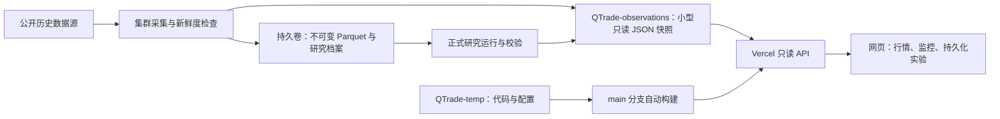

# QTrade 数据、因子、策略与实验盘点

盘点日期：2026-10-25，时区 Asia/Shanghai。数据来自本仓库的实际 Parquet、
manifest、研究报告和集群采集结果；数量不是 README 中的目标值。

## 1. 当前系统与数据流

对外网站是 <https://q-trade-temp.vercel.app/>。
<https://vercel.com/richman3/q-trade-temp> 是项目管理控制台。

采集与研究在集群运行。Vercel 承担网页和只读 API。代码发布与数据刷新是两条通道。
新的观测不覆盖旧实验使用的数据，实盘、外部订单和自动策略晋级保持关闭。

线上验收已完成：主分支合并 `97e2b21` 的生产 API 返回 HTTP 200，两路新鲜度为
`FRESH`；网页显示最新观测及 14 个持久化实验。最终研究代码 `300497a` 的 Linux
测试为 490 项通过，相关前端测试 42 项通过。

## 2. 数据资产

| 数据集 | 实际标的数 | Bars | 实际会话数 | 数据区间 | 主要用途与限制 |
| --- | ---: | ---: | ---: | --- | --- |
| 冻结 ETF 日线 | 30 | 28,770 | 959 | 2022-09-06—2026-08-21 | 原有日线研究；Sina raw，当前样本池、非 PIT |
| 冻结一分钟历史 | 97 | 115,430 | 5 | 2026-08-19—08-25 | 短窗口工程验证；各标的覆盖不齐 |
| 冻结短五分钟历史 | 101 | 193,920 | 40 | 2026-07-01—08-25 | 短期分钟诊断；不能据此认定多年稳定 |
| 冻结长五分钟历史 | 75 | 1,324,800 | 368 | 2025-01-02—2026-08-25 | 15 行业、每行业 5 股；BaoStock 前复权、非 PIT |
| 恢复的 ETF 日线首批 | 30 | 1,170 | 39 | 2026-08-24—10-23 | 补齐日线延续窗口；独立保存，不改旧版本 |
| 恢复的原生五分钟首批 | 75 | 7,200 | 2 | 2026-10-22—10-23 | Sina 最近 96 根/股；复权语义未经独立认证 |

前三类分钟数据中的股票/ETF 有交集，不能把 97、101、75 相加当成独立股票总数。
30 只 ETF 也不是 30 个相互独立的市场暴露。

日线延续研究已将同一 raw 口径的旧日线与新日线生成一个**新版本**，实际为
29,940 根、998 个会话、30 只 ETF，覆盖至 2026-10-23。合并会检查数据 checksum、
重复 Bar 冲突并重新通过质量门；原来的 28,770 根版本保持不变。

特别注意：

- 五分钟长样本的 368 个会话不能理解为区间内全部交易日均有覆盖；需要按交易所日历
  核对日期缺口，而不是只计算行数。
- 旧分钟数据结束于 8 月 25 日，新首批只有 10 月 22、23 日，中间缺口尚未补齐。
- 旧长分钟为前复权历史，新 Sina 分钟口径不同。不能直接拼接后宣称获得连续、同口径样本。
- 当前主要字段是 OHLCV。没有已认证 L2 五档盘口、完整公告原文库、公告首次可见时钟、
  历史成分股变更链或完整 PIT 财务库。
- raw ETF 价格不等于分红再投资总收益；前复权数据可能使用后来发生的复权信息。

原始盘点值和 checksum 见
[`deployment/research-inventory-20261025.json`](../deployment/research-inventory-20261025.json)。

## 3. 持续采集、新鲜度与发布

集群已有独立 Supervisor 采集进程。日线至多每小时采集一次；股票五分钟数据在工作日
市场窗口每 15 分钟采集一次，其余时段每 6 小时采集一次。失败保留前次成功数据并记录
失败状态，单次采集有超时和重试边界。

小型 JSON 快照每 5 分钟发布到
[`panxy1019/QTrade-observations`](https://github.com/panxy1019/QTrade-observations)。
只发布最新 Bar、数据身份、采集状态和已校验的实验摘要；完整 Parquet 和实验产物留在集群。
它是低吞吐研究观测通道，后续规模扩大时应迁至对象存储，避免把 Git 仓库当成行情数据库。

网站每分钟刷新显示。服务端每次读取会重新判断：

1. 发布文件是否完整、checksum 是否匹配；
2. 发布是否已超过 20 分钟；
3. 发布时采集进程是否有有效心跳；
4. 数据是否覆盖全部必需标的，是否满足当前交易日历与市场时钟；
5. 最近一次采集是否失败，价格、时间戳和报告身份是否有效。

日线在中国时间 16:30 后要求覆盖当日收盘；分钟检查考虑午休、周末、已登记节假日，
允许 20 分钟观测延迟。2026-10-25 是周日，因此最新覆盖至 10 月 23 日可以是正常状态。
“新鲜”只表示最新覆盖满足规则，不表示历史没有缺口，更不表示拥有授权实时行情。

公开接口：

- `/api/observations/latest`：观测快照与实验摘要；
- `/api/data-freshness`：按请求时钟计算的新鲜度；
- `/api/observations/health`：异常时 HTTP 503；
- `/api/persisted-experiments`：持久化实验目录。

这些接口没有公开写入方法。新鲜度响应不使用 Vercel 边缘缓存。GitHub 源文件仍可能
受其 CDN 延迟或故障影响；超时或过期会显示异常。交易日历覆盖到 2026-12-31，届满前须更新。

## 4. 现有因子与研究证据

目前已有价格因子实现、研究证据目录和实验产物，并不是一个自动吸纳任意 Python 文件的
通用因子平台。核心实现位于 `src/qtrade/research/factors.py`，网页证据目录位于
`web/src/research/factorEvidenceCatalog.ts`。

| 已有日线证据 ID | 定义 | 最少已完成收盘数 | 原发现期 Rank IC | 原发现期观察期数 |
| --- | --- | ---: | ---: | ---: |
| `momentum-60` | `close[t]/close[t-60]-1` | 61 | -0.0098 | 15 |
| `momentum-120-skip-20` | `close[t-20]/close[t-140]-1` | 141 | 0.0085 | 15 |
| `momentum-252-skip-20` | `close[t-20]/close[t-272]-1` | 273 | 0.0760 | 14 |
| `reversal-5` | `-(close[t]/close[t-5]-1)` | 6 | 0.2195 | 15 |
| `low_volatility-60` | 最近 60 个收盘收益率总体标准差的负值 | 61 | 0.0600 | 15 |

这些 IC 来自原有发现期诊断，不能当成最新样本外结论。原研究报告统一为 `NOT_ELIGIBLE`，
原因包括当前成分池回投、确认期已查看、单源历史短和缺少前向 PAPER/SHADOW 证据。
`reversal-5` 的较高发现期 IC 不等于已验证可交易 Alpha。

代码还实现了通用 `momentum`、`skipped_momentum`、`reversal`、`realized_volatility`、
`liquidity_turnover`，但函数存在不代表已经获得可靠输入或完成因子验证。
其中 `liquidity_turnover` 需要自由流通份额，当前连续 OHLCV 采集并未提供 PIT 流通份额。

| 日内因子/功能 | 实现状态 | 当前研究结论 |
| --- | --- | --- |
| 开盘三根十分钟阳线 | 将 09:35—10:00 六根完整 5m Bar 聚合，10:00 后才知道信号，后续 Bar 执行 | 长窗口有效性、稳健性与因果回测门未通过；只作诊断 |
| 自定义开盘方向规则 | 三根方向可取阳/阴/忽略，组合支持 ALL/ANY；受限规则，不执行任意代码 | 即时探索不能替代冻结实验与独立样本 |
| T+1 退出规则 | 支持下一会话开盘退出，或条件退出与尾盘回退等受限实现 | 必须按实际报告分支核对；时间标签不能混用 |
| 分钟风险覆盖层 | 趋势弱、波动、日内回撤、冷却状态可收缩日目标 | 是风险控制/诊断模块，不是新 Alpha 因子 |
| 五档盘口买入强度 | 有数据就绪与假设描述 | 没有认证 L2 数据，未验证；不能从 OHLCV 伪造 |
| 公告/事件文本因子 | 尚未建库、未采集、未评估 | 当前缺失 |
| LLM 自动因子挖掘 | 尚未集成统一生成、沙箱、预算及试验登记流水线 | 当前缺失 |

主要证据目录是 `deployment/evidence/factor-search`、`factor-robustness`、
`stock-sector-transfer`、`intraday-factor-long-window`。稳健性复用和事后策略搜索也保持
不可晋级，不能把重复使用同一窗口称为独立验证。

## 5. 现有策略与实验

| 目录中的策略模板 | 代码位置 | 网页因果预览 |
| --- | --- | --- |
| 等权买入持有基准 | `research/multi_asset.py: EqualWeightBuyHold` | 用于比较；不作为主动模板预览 |
| 移动平均趋势 | `strategies/baselines.py: MovingAverageTrendStrategy` | 单标的选择器尚未接通 |
| ETF 动量轮动 | `research/multi_asset.py: MomentumAllocation` | 支持 |
| ETF 动量 + 趋势/目标波动率约束 | 同上 | 支持 |
| 横截面因子排序 | `research/multi_asset.py: RankedFactorAllocation` | 支持反转、低波动率等已实现受限分支 |

此外有单股五分钟回测、分钟风险覆盖、开盘方向因子诊断和冻结前向观察协议。
“有实现”“有历史实验”“已注册策略”“已获 PAPER 准入”是不同状态；不能相互替代。

原 v4 的 11 个实验包括：

- 买入持有、60 日动量、多周期动量、动量 + 波动率、动量 + 趋势共 5 个主实验；
- 目标波动率低/高、调仓快/慢共 4 个敏感性实验；
- 低/高成本共 2 个成本压力实验。

旧记录及其真实 artifact、record/result hash 会按原身份保存；旧完整 run spec 缺失的部分
不会伪造，也不会声称旧 spec hash 已独立重建。

本轮新增三份固定规格：`continuation-momentum-v1.json`、`continuation-risk-v1.json`、
`continuation-reversal-v1.json`。训练时间 2022-09-06—2024-12-31，验证时间为 2025 年，
延续诊断窗口 2026-08-24—10-23；回测使用较早会话预热，指标只统计声明的诊断窗口。
每次都保存同窗口、同成本的等权基准。规则在本轮运行前固定，不按结果继续搜索参数。

这些是**事后历史延续诊断**，不是新获得的未见测试证据。39 个新日线会话不能支持
稳定盈利的结论，持久化成功也不改变 `NOT_ELIGIBLE`。

正式运行保存 `run-spec.json`、`dataset-manifest.json`、不可变实验 record、`result.json`、
equity/drawdown/trades/positions/risk/logs、基准产物、SQLite 离线备份和归档校验清单。
同 ID 同规格重跑读取已校验结果；同 ID 不同规格拒绝。文件损坏会阻止发布。
网页 localStorage 中的“本地实验”仍是本地探索，不会自动上传或变成正式实验。

本轮实际完成：原有 11 个实验已归档，3 个新正式运行已完成，共 14 个持久化目录。
新数据版本为 `etf30-continuation-20261023-078a1ae8b506`，运行代码提交为
`76835caad012ad97ce400d06d72f178a0e5321d7`。

| 固定诊断规则 | 2026-08-24—10-23 累计收益 | 同窗等权基准收益 | 最大回撤 | Sharpe |
| --- | ---: | ---: | ---: | ---: |
| 多周期动量轮动 | -2.52% | -8.06% | -6.87% | -0.817 |
| 动量 + 趋势/波动率约束 | -1.65% | -8.06% | -3.72% | -0.931 |
| 5 日反转排序 | -0.37% | -8.06% | -4.50% | -0.049 |

三组收益均为负。相对基准少亏不能证明存在可推广 Alpha；窗口短、非 PIT、事后观察和
raw 分红口径等限制仍在。指标已经计入配置中的手续费和滑点假设，真实成交可实现性未获认证。

## 6. 数据量与股票量够不够

| 目标 | 当前判断 | 下一步 |
| --- | --- | --- |
| 采集、监控、版本管理和回测工程验证 | 足够 | 先保证每天能采到、查到、重跑和发现异常 |
| 30 ETF 的固定规则轮动研究 | 足以作为起点 | 补分红/总收益口径，增加独立延续观察与成本检验 |
| 75 股日内固定假设诊断 | 可以做有边界的试验 | 补齐日期、核对复权、停牌与涨跌停执行约束 |
| 宣称策略可推广到全 A 股 | 不够 | PIT 股票池、退市样本、行业/市值覆盖、跨市场状态验证 |
| 大规模 LLM 自动搜索因子 | 当前不适合直接扩大搜索 | 先固定预算、保存全部尝试、建立隔离运行及独立测试门 |
| 公告与事件文本因子 | 当前没有必需数据 | 先构建原文、首次发布时间、抓取时间、修订版和标的映射 |

后续可把日频横截面覆盖逐步扩至 300—800 只流动性较好的股票、5—10 年历史，
分钟研究先做到 100—300 只、2—3 年同口径连续数据。这是分阶段的工程预算建议，
不是统计合格线；最终要看独立会话数、市场状态、有效样本量和实际尝试次数。
132 万根高度相关的分钟 Bar 不能当成 132 万个独立样本。

## 7. 建议的研究方向

先把现有价格/量因子和实验流程做成可重现基线，再加一个数据边界清楚的公告事件研究。
因子库和 LLM 辅助研究并不冲突：因子库承载定义、输入、可知时钟、版本与验证结果，
LLM 负责提出或实现候选，固定的评估流程负责裁决。

公告方向建议先选一种事件，如业绩预告的结构化偏离或回购进展，不同时混入多类事件。
必须保存原文 hash、公告首次发布时间、抓取时间、修订时间、文档版本、公司映射和
模型/prompt 版本。事件在交易时间后公布时，最早可交易点必须后移；后续修订不能回填成
历史上当时已知的文本。还要检查 LLM 的训练数据时间，不能默认其对旧公告的解释没有未来知识。

先比较词典/规则基线、结构化 LLM 提取和相同事件的价格反应，再考虑自动因子挖掘。
LLM 不直接发单，不根据已查看测试收益无限重写因子，不删除失败试验。

参考：PIT 的版本语义见 [Qlib PIT 文档](https://qlib.readthedocs.io/en/stable/advanced/PIT.html)；
LLM 协同提出假设、实现和实验反馈的公开项目可研究
[Microsoft RD-Agent](https://github.com/microsoft/RD-Agent) 及其
[RD-Agent-Quant 论文](https://arxiv.org/abs/2505.15155)。这些可作为工程参考，
不能替代本项目的数据与独立验证。

## 8. 后续操作

见 [`RESEARCH_WORKFLOW.md`](RESEARCH_WORKFLOW.md)。新增 GitHub 文件本身不会自动发现因子、
运行正式实验或把策略部署到集群。Vercel 的自动构建只解决网页/API 代码发布。
