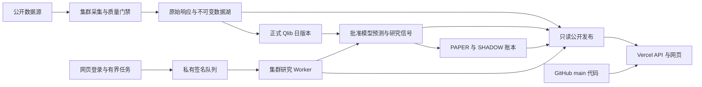

# QTrade 整体进度、当前效果与下一阶段开发报告

核验日期：2026-10-27，时区 Asia/Shanghai。主要现场快照时间为 **19:26—19:29**，交付前于 **19:38:45** 补做准备/版本/进程检查；每份证据保留各自实际时钟，不构成同一瞬间的原子快照。

本报告依据实际生产 GET、集群只读状态、当前源码、不可变历史验收证据，以及用户的 [STEP2 指南](../plans/STEP2_USER_GUIDE.txt)。状态会继续变化，下面的数字是有时间边界的检查结果。未更改生产策略、模型、训练政策或恢复授权。

**交付前最新检查：847/987 已准备，137 只未尝试、3 只等待重试；正式 head 仍截至 10 月 26 日，自动完成标记不存在，服务 PID 未变。** [19:38 凭证](evidence/qlib-overall-latest-preparation-1940-20261027.json)覆盖下文 19:27 的 798/987 旧检查点，但不改写旧证据。

## 1. 当前最准确的定位

**QTrade 已从旧 ETF/75 股展示工具，发展为以 Qlib 为核心的可操作日频研究平台；统一采集、正式版本、批准模型、预测、信号与持久前向账本的工程已经接通。当前主要处于 STEP1 的真实收盘整链验收阶段，尚未完成整个 C/D/E，STEP2 尚未正式启动。**

目前已经能够实际做的事情：

- 对统一 1,500 证券目标池持续采集日线和五分钟数据，保留原始响应、质量及缺口记录。
- 登录网页，配置允许列表中的 Alpha158＋Ridge/LightGBM 实验，提交集群任务、查看归档、申请取消或复用实验规格。
- 保存并独立恢复模型和训练期拟合的处理器；维护正式日版本、模型状态、人工激活/回滚门禁和每日预测档案。
- 查看七系列统一历史策略比较、独立 ETF 历史模拟，以及六类股票策略的 PAPER/SHADOW 持久账本。
- 通过真实公开交付检查，区分采集是否当前、目录是否新鲜、正式 Provider 是否就绪、当前预测是否可用。

还不能据此宣布的事情：

- 1,500 只证券都已有连续十年、同口径、完整历史 PIT 数据。
- 10 月 27 日正式 Qlib 版本及其预测、signals、候选后续验证、股票前向公开链已经通过。
- Alpha158 的 158 列都是独立验证有效的 Alpha，或者统一因子研发中心已经建好。
- 已有回测收益就是前向 PAPER 收益；当前零成交就是模拟成交能力已经验证。
- 网页已经开放 Qlib 官网所有模块，或支持任意因子代码/任意策略上传执行。

不提供一个混合的“总完成百分比”：代码实现、实际部署、单项验收、完整跨日验收与研究有效性是不同维度，简单相加会误导。

## 2. 本轮核验结果与证据边界

| 核验项 | 本轮实际结果 | 证据及能证明的范围 |
| --- | --- | --- |
| 正式网页构建 | `main b64b5f9e9a77a59a140d366fc1cf9a0186a90cfa` | 实际 `/api/deployment`，不是仅看构建平台的成功标记 |
| 完整行情公开核验 | 19:26:37 `FRESH_TRANSPORT`，耗时约 22.30 秒；索引/目录年龄 149.27/145.10 秒 | [完整探针](evidence/qlib-publication-probe-b64b5f9-20261027-1927.json)：1,500 身份、3,000 条目、目录/索引 Git 字节及五组固定 API/分片一致；不是全部证券原始响应重放 |
| 八个公开分区 | deployment、catalog、unified、comparison、stock-forward、ETF trend/forward/history 均取得实际 HTTP 200 JSON | [捕获清单](evidence/qlib-overall-public-20261027-1929/report.json)，保存原始 body、headers、SHA256、请求与接收时钟；捕获本身不签发 C/D/E 通过 |
| 集群准备与进程 | 19:27:21：798/987 已准备，187 未尝试，2 等待重试；十个 QTrade 受监管服务均 Running | [集群只读快照](evidence/qlib-overall-private-status-1930-20261027.json)，正式 head 仍为 10 月 26 日；未重启服务 |
| 交付前准备复核 | 19:38:45：847/987 已准备，137 未尝试，3 等待重试；正式 head 与进程 PID 不变 | [最新只读凭证](evidence/qlib-overall-latest-preparation-1940-20261027.json)，140 unresolved，不是 READY Provider |
| 正式版本数据量 | 990 份历史股票分区，签名元数据合计 2,158,792 行，数据截至 10 月 26 日 | [元数据检查](evidence/qlib-overall-dataset-metadata-1932-20261027.json)；本轮按签名 manifest 求和，没有重新逐份扫描全部 Parquet |
| 待部署修复 | [PR32](https://github.com/panxy1019/QTrade-temp/pull/32) 仍为 Draft，分支 `9619301`，生产未切换 | GitHub 连接器本轮核对；修复源码为 `c3e08c2`，当前冻结日任务继续运行旧的真实源码身份 |

上一轮心跳的集群检查曾被自动审批拒绝；本轮在用户明确要求整体检查后，较窄的只读检查已成功取得上述新证据。不能把上一轮未读取的数量补写成当时已确认。

## 3. 当前架构及自动更新究竟如何工作

这里有两条不同的更新通道。

**代码通道：** 开发分支修改 → 审查/测试 → 合并 GitHub `main` → Vercel 自动构建。新增页面、API 或允许列表能力需要这条通道。分支预览成功不等于正式默认地址已经切换。

**数据与结果通道：** 集群采集/研究 → 质量验证及归档 → 发布有界 JSON/行情对象 → Vercel API 读取 → 页面按各业务时钟刷新。正常新行情到来不需要每天重新部署网页。

训练、Qlib Provider、完整 Parquet、模型及实验主要保留在集群。Vercel 提供网页、只读结果 API，以及受保护的研究任务提交入口；它不承担长期训练进程。当前公开快照采用独立 Git 发布仓库，适合现阶段有界交付，但增长后应评估对象存储，而不是持续把 Git 扩成整个行情数据库。

## 4. 数据规模：1,500、990、987、798、888 分别是什么

| 数量 | 所指集合/阶段 | 不能解释成什么 |
| --- | --- | --- |
| 5,594 | 主表当前保存的证券身份，包含非目标/历史或停用身份 | 不是 5,594 只都正在采集、都可交易或都有合格历史 |
| 1,500 | 当前观察目标池：1,470 股票＋30 ETF | 不是全 A 股，也不是十年前真实可选成分池 |
| 1,497/1,500 | 10 月 27 日当前日线覆盖到要求收盘的目标数 | 不代表多年历史完整或已进入 Qlib 正式版本 |
| 1,496/1,500 | 当前五分钟覆盖到 15:00 的目标数 | 不代表所有日内网格/所有历史交易日均完整 |
| 990 | 原冻结研究股票池，以及正式版本保留历史分区的数量 | 不是平台最多只能支持 990 股 |
| 987 | 本次原 990 范围中拥有合格当日日线输入的股票 | 不表示所有后复权适配已完成，也不表示预测覆盖必为 987 |
| 798 | 19:27 快照中完成本次逐股准备的数量 | 不是新的 READY Provider 或已成功预测的数量 |
| 847 | 19:38 最新快照中完成准备的数量，尚余 140 unresolved | 不能把适配进度当端到端完成度 |
| 888 | 先前批准模型在 10 月 26 日正式版本上的合格预测分数数 | 不是采集目标数，也不是今天的准备范围 |

三只当前日线不合格证券为 `002827`、`600621`、`605258`。它们保留失败/缺失原因，不用默认行情补造。五分钟还存在额外失败/旧数据缺口；例如 `512580` 的保留缺口不能推断为停牌。

### 4.1 日线已经具备的研究基础

正式日版本保留 990 份历史分区，签名元数据合计 **2,158,792 行**，最近正式数据日是 **2026-10-26**。原基线的训练时间从 2017 年开始，固定测试为 2024-01-02—2026-10-23。

这些数量足以做当前规模的日频工程验证、基础信号/模型对照，以及具有明确边界的研究。制约可信度的主要问题已经不只是“股票数量少”，还包括当前流动性样本回投、退市样本、历史状态、公司行为、尝试次数和真正独立样本的缺失。

将当前池直接扩到 5,000 股，如果仍用今天的股票清单回测过去，并不会自动修复幸存者偏差。更重要的是形成当时可知的股票池、逐日资格与可交易状态，并在行业/市值/流动性/市场阶段上检查覆盖。

### 4.2 分钟数据的实际边界

统一当前五分钟采集与旧长期分钟材料是不同层次：

- 统一池已经有 1,500 个日线/五分钟采集计划，当前分钟大多数到达当日收盘。
- 旧长期分钟 checkpoint 曾有 172 份，较早复验为 171 份内容/覆盖通过、1 份隔离；这是旧合同的验收记录，不是当前 1,500 股多年分钟完成率。
- 旧 75 股材料、短窗口材料与当前 Sina 原生数据的证券有交集、来源和复权语义不同，不能简单相加或拼接。
- 尚未取得 1,500 股连续 2—3 年、更不用说十年五分钟同口径验收结果；没有认证 L2 盘口和逐笔数据。

当前公开行情查询有界提供最近 **20 个日线交易日/3 个五分钟交易日**；这是网页查询窗口，不是集群历史库存的总长度。分钟可查询，也不等于已经接通 Qlib 分钟 Provider、分钟 Alpha158 或嵌套高频执行研究。

### 4.3 历史回补与 PIT 当前做到了哪里

19:27 集群快照中的封存收据统计：

| 队列 | 内容合格行 | 已有内容合格范围 | 仍缺什么 |
| --- | ---: | ---: | --- |
| 当前观察池日线历史回补 | 1,440 | 120 个证券范围 | 完整多年窗口、独立来源、历史可得性 |
| 当前观察池五分钟历史回补 | 56,448 | 98 个证券范围 | 连续日历/网格、复权一致、长历史覆盖 |
| 上述两类合计 | 57,888 | 218 个频率范围，仍有未解决缺口 | 不是整个数据湖总量，也不是十年认证数量 |
| 独立退市试采 | 67 | 8 个有限范围 | 退市样本绝大部分仍未形成可用完整历史 |
| 当前 PIT 公共源刷新 | 上一轮处理 990/990 范围 | 当次公共源请求已完成 | 完整历史 PIT、当时可知上市/退市/ST/停复牌/公司行为仍未认证 |

与 17:52 的 49,032＋47 行比较，回补确实有进展。最新状态仍为 `YIELDED_TO_CURRENT_COLLECTION`：低优先级回补主动让当天采集和 Qlib 准备先运行。调度成功/进程 Running 不能解释成大块多年数据已经补齐。

退市队列仍保留质量拒绝、让路与一次登录失败等记录。当前来源尚不能给出可信的十年完工日期；不要把短窗口吞吐线性外推为多年保证。

### 4.4 空间和扩容安排

19:27 数据卷空闲 275.41 GiB，19:38 最新为 **275.39 GiB**。保留既有 **100 GiB** 底线后，约有 **175.39 GiB** 的工作余量；它不全部等于可以用于新增原始行情的空间，模型、实验、失败档案、索引和版本也会增长。

仅做量级预算，假设每年约 240 个有效交易日、每天 48 根五分钟线：1,500 证券十年约为 **360 万根日线、1.728 亿根五分钟线**。这只是行数模型；上市/退市、缺口、交易日历和不同证券交易制度会改变实际值。不能直接据此承诺磁盘够用：应对实际供应商原件、Parquet、重复观测、索引和实验产物测量每百万行占用，再决定分批规模和对象存储安排。

下一步优先保证连续增量和来源口径，长期回补继续有界推进；不能为了扩容数量混接不同复权口径，或降低保留空间阈值。

## 5. Qlib 接入程度及每日链路

当前集群固定使用已验收的 Qlib 0.9.7 研究环境。下表描述本项目实际接线，不能把“依赖包里有某个类”视为已经支持。

| 能力 | 当前程度 | 当前效果/边界 |
| --- | --- | --- |
| 初始化、本地 Provider、日历及 Data API | 已使用 | 真正调用 Qlib 计算；不是只导入人工填写的结果 |
| Alpha158、DatasetH、DataHandler/处理器 | 已使用 | 固定 158 特征，训练期归一化/缺失处理，冻结切分和标签 |
| Ridge、LightGBM | 已使用并有真实归档 | 当前正式网页允许列表的两类模型 |
| TopkDropout、Exchange、日频回测 | 已使用 | 原生 Qlib 回测；成本、容量与限制假设随实验保存 |
| WeightStrategyBase | 已用于统一比较的等权对照 | 不是当前网页已开放通用任意权重策略 |
| Recorder、MLflow、模型与结果持久化 | 已使用 | 参数、指标、模型、预测、持仓/会计产物和归档哈希可追溯 |
| 冻结处理器恢复、RMDLoader、IT_LS | 已真实独立验证 | 恢复不重新拟合；Ridge/LightGBM 均有跨进程一致性证据 |
| RollingGen、TrainerR | 已真实接入 | 候选训练/恢复已完成；生产滚动政策仍 OFF |
| 每日日版本、预测、signals | 工程已接通，当前日整链待验收 | 已有 10 月 26 日正式版本/预测，10 月 27 日仍在准备 |
| 在线生命周期 | 自有协调器与注册/审批/回退实现 | 不是直接部署原生 OnlineManager/PredUpdater 的完整调度体系 |
| 任务管理 | 自有私有 Git＋SQLite | 支持有界提交、取消、超时、归档和中断处理；不是 MongoDB TaskManager |
| 因子独立评价 | 有基础函数和旧工具，统一任务产品待补 | 模型整体 IC 不等于逐因子评价 |
| 财务 PIT、通用公式工作台 | 未作为正式完整能力接入 | 公共源状态修复不等于原生财务 PIT 数据库 |
| Alpha360、XGBoost、指数增强优化 | 未进入正式网页允许合同 | 需要逐项适配、输入审计及同协议比较 |
| Qlib-Server、共享远程缓存、RL、Meta Controller、嵌套高频执行 | 未发现正式接线 | 当前研究目标不需要为了凑全目录提前建设 |

较早的 [10 月 26 日模块盘点](QLIB_MODULE_INTEGRATION_AUDIT_20261026.md)保留了当时的“恢复/滚动/在线未接入”记录，已经被较新的代码和证据部分覆盖。本报告不沿用那些旧状态当作今天的结论。

### 5.1 当前三个模型状态

| 模型 | 状态 | 含义 |
| --- | --- | --- |
| Alpha158＋LightGBM，`2d78cc4c…` | ACTIVE，激活次数 1 | 用户已经批准的持续研究预测模型，保持不变 |
| Alpha158＋Ridge，`d6c232d1…` | STAGED，激活次数 0 | 已有验证/归档能力，当前不是 ACTIVE |
| 滚动 LightGBM，`29589b44…` | TRAINED，激活次数 0 | 已完成候选训练和恢复，仍等更晚真实版本验证，不能自动替换 ACTIVE |

滚动 OFF 只阻止新的自动滚动训练；不阻止既有 TRAINED 候选在更晚合格版本上的独立验证。验证通过也不等于获得激活授权。

### 5.2 当天行情新，为什么模型还是旧日期

这是多个数据阶段产生的真实差异：

1. 统一源已取得 10 月 27 日合格收盘。
2. Qlib 逐股核验旧历史哈希、前一日 OHLCV 重叠、成交额/VWAP、后复权因子前缀，保存新原件和新分区。
3. 基准、日历、Provider 构建和独立恢复通过后，才能原子推进正式 head。
4. 正式版本事件触发批准模型推理，再产生候选验证和 signals，最后更新前向账本及公开交付。

因此“行情 10 月 27 日”“正式版本 10 月 26 日”“历史固定回测截止 10 月 23 日”可以同时为真。问题在于页面是否清楚标明身份和落后状态；不能把旧实验日期改成今天来制造一致。

本轮公开 catalog 明确给出 `current_prediction_usable=false`、`expected_complete_day=2026-10-27`；股票前向明确报 `FORWARD_SERVICE_DATA_STALE`。这是当前尚未闭合的整链，不应被一个绿色心跳掩盖。

| 常见状态 | 正确含义 |
| --- | --- |
| 服务 `WAITING` 且心跳新鲜 | 可以是在等既有周期/冷却，不等于停用 |
| `PREPARATION_ONLY_NOT_A_READY_QLIB_VERSION` | 只完成部分适配，不能供给新的正式日预测 |
| `RESEARCH_READY_QUALIFIED_SUBSET` | 某个明确数据日的合格研究子集，仍受日期和当前性检查 |
| `COMPLETE_DIAGNOSTIC` | 冻结诊断计算完成，不是已证明可交易或获得前向有效性 |
| `FRESH_TRANSPORT` | 公开数据交付时效/身份通过，不等于全池覆盖或最新 Provider |
| `DEGRADED` / `FORWARD_SERVICE_DATA_STALE` | 服务有心跳但业务前提不合格，须看具体错误与正式 head |

### 5.3 当前研究表单仍有一个产品边界

正式研究表单固定 `daily-liquid-990-20261023`、Alpha158，以及历史切分上限 10 月 23 日；在线日预测则使用逐日正式 head。二者当前并不是“任意选择最新 Provider 重新训练”的统一入口。

表单已经支持有界 Top-K、替换数、持有步、风险仓位、成本和资金参数，但仍需后续把可选择的不可变数据版本、特征集和策略版本接入统一规格，才能更自然地开展新日版本研究。新增数据版本不会自动重训所有旧实验，也不应改写它们。

## 6. 因子与策略：已有基础和真正缺口

### 6.1 因子分层盘点

| 层次 | 已有内容 | 当前没有完成的部分 |
| --- | --- | --- |
| Alpha158 | 158 个模型输入特征，包含价量/VWAP 相关表达式 | 尚未作为 158 个独立因子逐条登记、批量评价和版本管理 |
| 统一规则信号 | 20 会话动量、5 会话反转、20 会话负波动，及等秩多因子、全池等权 | 尚未统一引用 Factor Registry 中的正式版本 |
| 旧日线证据 | `momentum-60`、`momentum-120-skip-20`、`momentum-252-skip-20`、`reversal-5`、`low_volatility-60` | 旧发现/稳健性窗口不是最新独立测试，不可直接当晋级资格 |
| 因子计算/评价函数 | momentum、skipped momentum、reversal、volatility、turnover；IC/RankIC/ICIR、分组、换手、多空价差等 | 需要统一任务、固定数据/标签/时间/股票池和标准报告；自由流通份额等输入还受 PIT 约束 |
| 分钟工作台 | 有界开盘方向规则、风险覆盖、退出规则、成本/延迟/placebo/相关性诊断 | 旧研究范围独立保留，不是通用因子代码引擎或全池分钟平台 |
| 公告/事件文本、LLM/RD-Agent | 尚未形成正式流水线 | 原文和首次可见时点、版本修订、事件标签、试验预算、独立评估均待建设 |

所以不是“还没有因子计算或指标”，而是**缺统一身份、依赖/时点、可复用版本、独立实验任务及评价产品**。Alpha158 特征数、五个旧证据条目和五组每日信号不能相加称为“168 个有效因子”。

### 6.2 策略注册也有可以复用的核心

现有 `StrategySpec/StrategyRegistry` 已能保存策略身份、family/version、父版本、代码、数据/股票池、factor set、模型、组合规则、参数、切分、时钟和状态/角色记录。

缺口是把 Qlib 信号来源→组合→执行规则→数据/因子/模型版本统一接入该生命周期及网页操作。旧预览仍会标为 `AD_HOC_UNREGISTERED`、`registry_write=false`。不需要再从零另写一套底层注册器。

### 6.3 目前“七策略”“十二账本”“旧模板”并不矛盾

- **七策略历史对照：** 三个基础规则、等秩多因子、全池等权、Ridge、LightGBM。
- **六类股票前向策略：** 五组规则＋当前批准的一个模型；每类有 PAPER/SHADOW 两种模式，共 12 本账本。Ridge 当前未 ACTIVE，因此没有同时成为第二个批准模型前向账户。
- **旧五模板：** 等权、移动平均趋势、ETF 多周期动量、动量＋趋势/目标波动、横截面因子排序；属于历史工具范围。
- **独立 ETF：** native close 趋势轮动及其单独的历史模拟/SHADOW 合同，不冒充股票第八个模型。

## 7. 已经实现的历史研究效果

### 7.1 股票统一七系列历史对照

下面是本轮公开接口再次取得的同一份不可变对照：`f6b9e52b…`，共同样本 **601,013 行**、组合评价 **678 个交易会话**，区间 **2024-01-02—2026-10-23**。数据是事后诊断性样本外历史，含当前池回投/筛选偏差，**不是未来收益承诺或前向业绩**。

| 系列 | 成本后区间收益 | 成本后年化 | 最大回撤 | Sharpe | RankIC |
| --- | ---: | ---: | ---: | ---: | ---: |
| 20 日动量 | 2.33% | 0.86% | -46.17% | 0.211 | -0.0275 |
| 5 日反转 | 46.99% | 15.39% | -40.23% | 0.574 | 0.0173 |
| 20 日低波 | 53.01% | 17.13% | -12.33% | 1.164 | 0.0348 |
| 等秩多因子 | 65.12% | 20.49% | -14.53% | 1.206 | 0.0261 |
| 全池等权配置对照 | 102.16% | 29.90% | -21.75% | 1.181 | 不适用 |
| Ridge | 87.47% | 26.31% | -32.18% | 1.214 | 0.0467 |
| LightGBM | 126.71% | 35.56% | -32.17% | 1.271 | 0.0518 |

同期沪深 300 区间收益约 19.65%。来源：[当前公开比较](evidence/qlib-overall-public-20261027-1929/comparison.body.json)、[比较合同](QLIB_UNIFIED_STRATEGY_COMPARISON.md)。

六个排名系列使用相同 TopkDropout 设置：Top50、每天最多替换 5 只、至少持有 2 个交易步、95% 风险仓位。等权系列使用 WeightStrategyBase、每天等权再平衡，没有相同的 TopkDropout 持有合同；它是组合配置对照，不能把全部差异仅归因于信号。

典型冻结研究假设包括：买入 8bps、卖出 13bps、最低 5 元、100 股手数、前一会话成交量 1% 容量、保守 4.5% 方向开盘跳空代理，以及已冻结的来源附加约束。该归档绑定 **V1** 约束合同，不能重标成后来的 V2。历史 ST/精确涨跌停、公司行为、竞价和冲击未完整认证；科创板资格按具体归档政策处理，不能对旧新版本一概而论。

这份结果能说明比较/会计/归档链已经工作，也能提出研究问题，例如低波与多因子的回撤小于两个模型、等权换手明显更低。它不足以证明模型能稳定赚钱。下一步应研究共同池/风险暴露、成本和容量、时间段稳定性及真正前向表现，而不是只按累计收益选择最优曲线。

模型卡、最初迁移基线、统一共同面板和滚动窗口可能给出不同指标，因为输入资格、区间和合同不同；应核对实验 ID、协议与样本，而不是把不同报告混为同一次运行。

### 7.2 ETF 独立效果

- 当前日诊断已到 **2026-10-27，30/30** native closes 合格。
- `positive20` 规则按正 20 会话动量选 Top3，95% 预算，形成下一交易日研究目标。
- 指定 10 月 27 日目标的三项收盘输入已通过本地及实际公开输入/原始来源独立审计。10 月 28 日目标仍为 prospective，尚未观察。
- 当前公开 ETF SHADOW 为 RUNNING、无 errors；订单/成交/持仓为空，现金/NAV/前向收益为空。
- 另有 34 会话的假设式历史模拟：趋势 Top3 约 **-15.63%**，同池每日等权约 **-8.08%**。这是独立历史模拟，不能写成 SHADOW 已经亏损这些数值。

ETF 模拟采用原生价格和未认证的复权/分红口径，手数、费用、滑点和无限容量属于假设；真实 ETF 交易/交收及价格限制没有因此获准。来源：[ETF 公开历史模拟](evidence/qlib-overall-public-20261027-1929/etf-history.body.json)、[当前 SHADOW](evidence/qlib-overall-public-20261027-1929/etf-forward.body.json)、[已通过的指定观察](evidence/qlib-etf-forward-public-audit-1805-20261027.json)。

## 8. PAPER/SHADOW 与交易约束的实际效果

当前六类股票策略均有 10 月 27 日会话收据。公开服务整体为 **DEGRADED**，错误为 `FORWARD_SERVICE_DATA_STALE`；原因是正式 Provider 仍落后，而不是十个后台进程停止。

| 项目 | 本轮公开观察 | 应如何解读 |
| --- | --- | --- |
| 股票账本数 | 12，本日各有观察收据 | 6 类策略×2 模式，不是 12 种独立算法 |
| PAPER 状态 | 六本 running=true、NORMAL、无需恢复 | 说明已获各自模拟运行资格；不授权实盘 |
| PAPER 成交/持仓 | 本日均为 0 | 未认证输入/交易条件等门禁阻断，不能为了产生成交而放宽 |
| PAPER 阻断 | 每本 Top50 类 50 项，全池等权 885 项；六本共 1,135 项 | 是阻断计数，不是订单成交数量或 1,135 个独立风险事件 |
| PAPER 现金/NAV | 每本 100 万/100 万，观察收益 0 | 纯现金、无成交的机械结果，不是 Alpha 或执行收益证据 |
| 股票 SHADOW | 本日 SHADOW_OBSERVED，无成交/实际持仓/组合 NAV | 记录目标及后续输入；其 running=false 不应直接解释成托管服务掉线 |
| ETF SHADOW | 独立 RUNNING、三项输入观察通过 | 不产生模拟成交、持仓、NAV 或收益 |

已有执行栈复用组合→风险→OMS→模拟执行→会计，检查 T+1、手数、现金、费用及容量等约束。未知历史 ST/停牌/涨跌停/交收条件不能从价格缺失推断；无可靠规则的证券继续阻断。

当前已恢复的 PAPER 进程仍为 `175982`。此前用户批准的 LightGBM PAPER 单次恢复已经消费，不能因为验收需要再次重启/恢复或重复请求。`LIVE_TRADING_ENABLED=false`，策略不访问交易网关。

## 9. 网页各页面目前的职责

本节依据当前生产源码路由和本轮 API；本轮没有重新做逐页渲染/截图验收。页面功能存在不等于本轮已重新验证登录、提交或每个按钮。

| 页面 | 主要用途 | 当前操作边界 |
| --- | --- | --- |
| [总览](https://q-trade-temp.vercel.app/#/) | 汇总采集、模型、预测、前向状态 | 各分区使用自身时钟，不以页面刷新时间冒充数据时间 |
| [行情中心](https://q-trade-temp.vercel.app/#/market) | 统一目标池日线/5 分钟查询和图表 | 只读、窗口有界、缺失不补造；不再仅限旧 75 股 |
| [数据中心](https://q-trade-temp.vercel.app/#/data) | 主表、目标池、覆盖、质量和回补 | 当前增量、旧长历史、Provider 必须分开看 |
| [策略中心](https://q-trade-temp.vercel.app/#/strategies) | 当前支持的研究规格/模型入口 | 不是任意策略库或当前持仓列表 |
| [策略研究](https://q-trade-temp.vercel.app/#/research) | 登录、配置有界实验、提交集群 | 仅允许列表 Alpha158＋Ridge/LightGBM，不能任意上传 Python/YAML |
| [实验中心](https://q-trade-temp.vercel.app/#/experiments) | 队列状态、心跳、归档、复用和导出 | 登录后研究任务取消是申请，以 worker 最终收据为准 |
| [回测分析](https://q-trade-temp.vercel.app/#/backtest) | 完成实验、相容实验对照、七系列、独立 ETF 模拟 | 历史归档固定，不随当天采集改写收益或日期 |
| [在线模型](https://q-trade-temp.vercel.app/#/models) | 正式版本、模型/候选、预测、政策和控制回执 | 激活/回滚/数据回退/训练政策均受登录与各自门禁保护；提交队列不代表操作已完成 |
| [每日研究信号](https://q-trade-temp.vercel.app/#/signals) | 规则/模型分数、指示权重及版本绑定 | 分数和指示权重不是模拟实际成交/持仓 |
| 模拟交易/持仓/委托与成交/风控 | 同一持久前向账本的不同关注视图 | 公网只读刷新/选账本，不通过这些页执行启动、恢复、交易撤单或发送真实订单 |
| [历史工作区](https://q-trade-temp.vercel.app/#/archive) | 旧 ETF/分钟/120 会话证据和工具 | 旧 8 月日期可以保留，但必须有冻结范围和历史标签 |
| [系统监控](https://q-trade-temp.vercel.app/#/monitor) | 服务/发布/参考分区状态 | 进程健康不替代业务数据和正式版本验收 |

尤其要分清：**取消研究任务**与**撤销交易订单**是两个不同权限。当前公网有前者的受保护入口，不能因此描述为公网开放交易控制。模型激活也不是任意时刻都可执行：要求合格当前日数据、最新输入验证、状态正确、原 ACTIVE 一致和未来执行窗口；旧头状态下门禁会拒绝。

## 10. STEP1 的完成度按里程碑核对

| 阶段 | 已实现/已有真实证据 | 当前仍待交付或验收 |
| --- | --- | --- |
| A：主表/统一目标池 | 5,594 身份、1,500 目标、频率独立计划、旧范围映射 | 历史时点资格长期修复，不把当前池当历史池 |
| B：持续采集/质量/发布 | 当前日线与五分钟大多数覆盖；原始/标准化/质量/隔离；统一行情查询；多轮真实公开交付 | 剩余缺口、多年连续覆盖、来源及复权一致性、持续而非点状时效验证 |
| C：正式版本/日预测 | 版本/READY/事件/回退、冻结恢复和批准模型推理已有真实工作链 | 10 月 27 日 READY＋自动完成＋新预测＋signals＋实际生产公开审计 |
| D：滚动/模型管理 | 原生滚动候选训练/恢复，人工激活门禁，失败保留 ACTIVE，政策 OFF | 候选在本次更晚真实版本上的唯一验证任务、proof、注册状态链审计；不激活候选 |
| E：历史/信号/前向 | 七系列统一历史、独立 ETF、12 股票账本；指定 ETF 当日观察已通过 | 股票全局/公开链从旧 Provider 降级恢复，真实收盘账户/阻断/估值审计，后续连续会话证据 |
| 网页统一 | 当前行情/研究/历史/在线/前向已分区接线 | 本次新构建的明确视觉验收及状态文案继续统一；不能只看 API 200 |
| STEP2 | 已有可复用的因子/评价/注册器基础 | 用户要求 STEP1 全部真实验收后，再建设正式研究核心 |

完整历史 PIT 不会因 STEP1 工程验收通过就自动变成认证。STEP1 的边界包括把未知状态公开保留并拒绝不可靠执行；“限制已展示”不等于“数据已修复”。

## 11. 目前最需要处理的几个问题

### P0：完成真实收盘链，保留失败证据

目前主要门禁是新 Provider 尚未完成。19:27 尚有 187 只未尝试，19:38 已降至 137 只，约需六个有效新证券批次，另有重试和构建/恢复。按既有节奏首遍规划仍约 **20:10—20:30**；这是有网络/调度不确定性的估计，不是整个 C/D/E 的完成承诺。

现有 [剩余门禁清单](QLIB_CLOSE_REMAINING_GATES_20261027.md)已经说明：正式 head/completion → 精确批准预测 → 候选验证与 signals → C/D/股票前向的独立实际审计。C 的本次公开验收必须在 **10 月 28 日 09:30 上海时间之前**满足真实时钟窗口；错过则保留失败，不调整时钟补验。

预测的确定性 claim 一旦 FAILED/INTERRUPTED/SUPERSEDED，不会自动重新排队，可能阻断候选验证和 signals。当前没有发现本次新版本已触发该失败；它是需要预先检查的静态风险，不应以重启/删档来“修复”。

### P0：部署已测试的调度修复，但不破坏当前冻结任务

已发现父/子启动抖动约 16ms 导致整轮多等五分钟。`c3e08c2` 的修复只对合法签名、aware 的原 deadline 等待一次，再用真实 UTC 重走全部门禁，保留单个 900 秒 alarm、原 owner 和 25 新＋5 重试预算。

相同 56 项检查在 Windows 和实际 Linux 均通过，另有独立复核及 Ruff/mypy。不是 112 个不同测试。当前任务冻结源 `55b5b004`，所以 [PR32](https://github.com/panxy1019/QTrade-temp/pull/32)保持 Draft，尚不切换 data owner；不得改冻结 request，或让新代码谎报旧 revision。待本次请求完成/另行审查解决后才部署实际新源码。

### P0：治理重复/不同口径的状态字段

当前源记录存在多套不同语义计数：master 的初始历史资格、当前 incremental counts、retry_queue、旧 `pending_symbols`、正式版本和模型分数。本次 progress 的 `pending_symbols=188`，但 retry_queue 为 187 未尝试＋2 等待＝189 unresolved；后续应明确字段定义并统一展示，不能拿其中一个字段直接当整个平台完成量。

页面至少应共同显示：来源/研究范围、实际数据截止日、发布时间、模型/信号生成时间、预期执行时间、缺失/排除数。旧研究日期保持原样，当前状态按真实时钟显示。

### P0 并行：PIT、交易状态与数据发布可靠性

继续推进当前公共源可核验的上市/退市身份、ST/交易状态、OHLCV/金额、公司行动和缺口核对；未证明历史可得性时保持 `available_at` 未知。

行情导出恢复已有多轮暖运行和点状公网成功，但保留首次冷启动超 45 秒、Git 积压以及偶发 HTTP 获取失败的事实。不得增加既有导出/空间/发布预算掩盖问题。后续需监控 p95/p99、连续会话覆盖、索引年龄和失败后的恢复能力，再谈稳定 SLA。

## 12. 下一阶段开发计划与验收标准

### 12.1 先收口 STEP1，不新增研究范围掩盖门禁

| 顺序 | 具体工作 | 完成标准 |
| --- | --- | --- |
| S1 | 等当前 owner 完成本日适配及正式构建 | 真实 10 月 27 日 head、完整版本校验、自动 completion 一致，缺失证券清单保留 |
| S2 | 批准模型自动预测 | 精确绑定 model/approval/data/event/code；任务 COMPLETE；模型/处理器未重新拟合，归档不可变 |
| S3 | 候选 later-version 验证，然后 signals | 唯一候选任务/归档/注册证据和状态链一致，原 ACTIVE/approval 不变、候选 activation 仍为 0；signals 在候选任务结束、worker 空闲后生成并独立核验 |
| S4 | 股票前向与公开交付审计 | 十二账本、本地会计、真实公开 wrapper→内层签名绑定、最新版本与时效分别通过；不重启 PAPER |
| S5 | 部署调度修复与页面确认 | 当前冻结任务解决后使用新真实 revision；新服务状态/普通轮次验证；不把 Vercel 预览成功当正式切换 |
| S6 | 汇总 STEP1 验收包 | 实现、测试、集群、生产、视觉范围、复现命令和限制逐项对应，未通过项明确保留 |

这几个步骤和长期历史/PIT 修复并行；不需要把所有证券的十年 PIT 伪装完成，才能如实接受工程边界，但必须保留其对研究/执行的限制。

### 12.2 STEP2 P0：把因子与策略研发变成核心能力

以下是待开发计划，不表示本轮已经实施；复用现有引擎/注册器/队列，不另建网站。

| 交付 | 复用基础 | 新增内容及明确验收 |
| --- | --- | --- |
| P0-1 Factor Registry | Qlib 表达式/DataHandler、PriceFactorSpec、现有因子函数 | 每个因子有 ID/公式/版本/输入/窗口/频率/可知时点/缺失政策/代码与数据依赖；先登记现有基础因子和 Alpha158，日信号引用具体版本 |
| P0-2 独立 Factor Evaluation | 已有 IC/分组/换手/稳健性函数、Qlib 标签和评价 | 独立有界任务固定数据/标签/切分/股票池/因子版本；报告逐日 IC/RankIC、分组与多空、稳定性、覆盖、相关矩阵；全部尝试/失败保留 |
| P0-3 统一历史策略研发 | 已有七系列共同面板、Qlib Exchange | 将登记因子/因子组合/Ridge/LightGBM 走同协议对照；组合规则轴与信号轴分开；固定成本/容量/区间，不按最好曲线悄悄换口径 |
| P0-4 Strategy Registry 接线 | 已有 StrategySpec/SQLite 生命周期 | 正式注册信号来源、模型/因子/数据版本、组合、执行、成本和时间合同；网页从注册规格创建实验，并可追溯/复现/比较 |

独立因子评价应与统一策略比较同时存在。单因子 IC 好，不保证经 Top-K/换手/交易约束后收益好；策略收益好，也不证明某个输入因子有独立增量。

建议先用动量/反转/低波及现有 Alpha158 验证闭环，控制新候选数量；补充分组稳定性、年度/行情阶段、行业/市值/流动性暴露，以及多重尝试记录。明确哪些数据是已经查看的历史，哪些才是冻结后的前向样本。

### 12.3 STEP2 P1：可配置研发与连续前向

1. **Strategy Builder：** 登录后从允许列表选择因子/特征集/模型、Top-K/权重方法、调仓和持有规则、成本及执行约束，生成正式可版本化规格；不接受任意 Python 或任意路径执行。
2. **数据版本选择：** 将已验收的不可变正式版本接入新实验，而不只固定 10 月 23 日历史 dataset；保持原实验、原训练数据与每日在线预测的区别。
3. **连续 PAPER/SHADOW：** 分别记录分数、目标、阻断、模拟实际成交、持仓、现金和前向收益，积累跨会话证据；仅 PAPER 形成模拟会计和收益，SHADOW 对应执行/会计字段继续保持空/零/null。未知约束继续阻断，不以成交数量为验收目标。
4. **模型/特征扩展：** 再加入 XGBoost、Alpha360 等受控对照，固定数据和组合条件、保存环境和恢复证明；比较的是新模型增量，而不是同时换所有条件。
5. **分析产品：** 增加成本/容量压力、持仓和风险暴露解释、年度/分组稳定性及失败原因下钻，让用户知道收益来自何处。

### 12.4 后续再进入 LLM 与公告/事件

统一评价和注册建成后，LLM 才有可靠的接入位置：提出候选公式/研究假设、结构化公告事件、生成受限实现，再由固定流水线评价；LLM 不能自行决定某个策略有效或获得交易资格。

公告事件先建立原文、首次发布时间、抓取时间、修订版、证券映射和事件标签，确保模型只能看到当时可得内容。对生成次数和工具调用设置预算，保存全部候选，隔离开发/验证/前向集合，再考虑 WorldQuant 公式扩展或 RD-Agent。当前这些能力未正式集成。

## 13. 后续如何添加因子或制定策略

### 当前可直接使用的方式

在策略研究页登录，选择当前支持的模型与参数，提交正式任务；集群完成后，归档与只读发布通道使结果进入实验中心/回测分析。新增任务无需为了更新结果重新部署 Vercel。

### 当前尚不能做到的方式

仅在 GitHub 新增一个 Python 文件，不会自动登记因子、训练、评价或成为网页可选策略。GitHub main 变更只负责部署代码；研究能力还需要明确合同、允许列表、worker 分发、版本/归档和前端入口。

### STEP2 建成后的目标操作流

研究假设 → 注册因子版本与输入时点 → 固定独立评价 → 查看相关性/稳定性 → 注册策略规格 → 同协议历史对照 → 人工审查 → 连续 SHADOW/PAPER。源码变更通过 Git；具体研究任务、参数和结果通过受保护平台管理，二者各有记录。

这使“因子库”“策略研发”和“LLM 候选生成”成为互相衔接的环节，而不是三个互相替代的方向。

## 14. 本次检查做了什么、没有证明什么

本次进行了：仓库状态/路由/允许列表/注册器的只读复核，两个并行只读模块盘点，集群进程/正式 head/模型状态/准备/历史/PIT/磁盘的实际只读检查，正式生产构建和八个 API 捕获，以及完整行情公开探针。保存了原始响应和精确哈希，并按当前源码更新了阶段判断。

本次没有启动新训练、改变数据 owner、激活候选、开启滚动、重启/恢复 PAPER、触发 ETF 再修复或连接实盘。没有重新跑全库回归或重新逐页截图；历史测试的通过数引用各自固定源码与实际证据，不能汇总成一个重复计数的“当前总测试数”。

核心源码/证据入口：

- [当前状态](../CURRENT_STATE.md)、[总计划](../plans/MASTER_PLAN.md)、[STEP1/STEP2 计划](../plans/STEP1_STEP2_EXECUTION.md)、[决策记录](../DECISIONS.md)。
- [收盘恢复与正反证据](QLIB_CLOSE_EXPORT_RECOVERY_20261027.md)、[剩余门禁与复现命令](QLIB_CLOSE_REMAINING_GATES_20261027.md)。
- [正式研究规格](../src/qtrade/research/workflow.py)、[Qlib worker](../scripts/run_qlib_worker.py)、[每日版本服务](../scripts/run_qlib_data_service.py)。
- [因子函数](../src/qtrade/research/factors.py)、[独立指标基础](../src/qtrade/research/metrics.py)、[策略注册器](../src/qtrade/strategies/registry.py)。
- [统一比较合同](QLIB_UNIFIED_STRATEGY_COMPARISON.md)、[ETF 历史模拟边界](QLIB_ETF_HISTORY_COMPARISON.md)、[训练态恢复](QLIB_FITTED_RESTORE.md)、[滚动训练](QLIB_ROLLING_TRAINING.md)。
- [学习文档目录](learning/README.md)：帮助阅读模型、因子、回测和平台组件；旧时间检查点须结合本报告理解。
