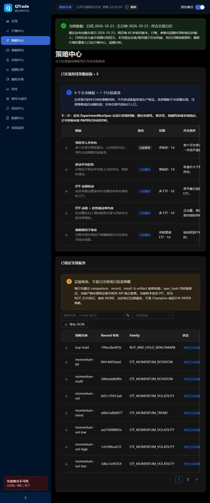

# 02｜策略中心逐组件详解

[返回学习目录](README.md) · [打开策略中心](https://q-trade-temp.vercel.app/#/strategies)

## 1. 页面为什么分成上下两部分

上方“已实现基线策略模板”回答“代码能表达哪些策略结构”；下方“已验证实验候选”回答“哪些历史运行有能核验的记录”。模板是菜谱，实验是按某套食材和参数做过的一次菜。两者不是一一对应，某个模板可以生成许多实验。

当前上方为 5 个模板，其中 4 个主动、1 个比较基准。下方使用原来的 11 个实验记录，每页 8 条；并没有自动收录所有延续实验和 Qlib 归档。

## 2. 模板表每一列怎么读

| 列/控件 | 含义 | 你需要检查 |
|---|---|---|
| 模板 | 算法名称和描述 | 是单标的择时还是多标的选股？ |
| 角色 | ACTIVE_BASELINE 或 BENCHMARK_ONLY | 主动方法与比较基准不要混为一谈 |
| 范围 | 多 ETF、单标的、多股票或 ETF；数据频率 | 范围是算法接口，不等于本次已装载这么多数据 |
| 开仓条件 | 生成买入/持仓目标的条件 | 条件在何时才可知？ |
| 平仓条件 | 何时减仓/退出 | 是否有退出权限、可卖数量与成交限制？ |
| 验证状态 | 已实现·未生产验证 | 功能存在，不等于策略有效 |
| 载入因果回测 | 带模板身份进入回测入口 | 只是载入默认值；应核对回测页实际选中的模板和参数 |
| 行首展开箭头 | 查看实现、默认参数、输入和限制 | 默认参数尚未冻结成一次实验 |

“尚未接入该实验室”不表示算法不存在，也不表示已经用其他方式验证成功；它只说明该 UI 入口未接通。

## 3. 五种模板的原理

### 3.1 等权买入并持有

先分配等额资金买入标的，以后尽量保持数量，用来与主动策略比较。教学例子：10 万元、5 个标的，初始每个约 2 万元；价格涨跌后，各自权重会漂移。

**买入持有不等于每天恢复等权。** 后者需要不断买卖，会有额外成本。当前目录把它标为比较基准，不作为独立主动模板预览。

### 3.2 移动平均趋势

N 日简单移动平均：

    MA_N(t) = 最近 N 个已完成收盘价的平均值

收盘价大于等于均线时生成持仓目标，低于均线则生成零目标。默认窗口 20、数量 100；目录的单标日日线选择器尚未接入实验室。

它试图保留趋势、降低持续下跌的暴露，但均线有滞后，震荡时可能反复买卖。“跌破后清仓”是目标，不能保证真实市场立即成交。

### 3.3 ETF 动量轮动

默认使用 20、60、120 日周期，Top3，每 20 个会话调仓，预留 5% 现金。当前 MomentumAllocation 将不同周期涨幅作平均，选正得分中排名靠前者；不是机器学习模型，也不是对未来收益的概率预测。

教学例子：某 ETF 的三个周期收益为 2%、4%、9%，均值为 5%；另一个为 -1%、2%、3%，均值约 1.33%。前者排名更高。实际策略还要满足足够预热历史、可交易和资金等条件。

多周期可以减少单个窗口的偶然影响，但这些信号通常高度相关，不能当作三个独立证据。

### 3.4 ETF 动量＋趋势波动率约束

在动量排序之外，增加价格不低于趋势均线的资格过滤，并根据历史波动率缩小仓位。目录默认趋势窗口 120、波动窗口 20、目标年化波动率 15%。

当前每个被选标的的缩放近似为：

    scale_i = min(1, target_volatility / estimated_volatility_i)
    weight_i = (1 - cash_reserve) / selected_count × scale_i

该实现只降低仓位，不加杠杆。它不是把完整组合波动率精确控制在 15%，因为没有在这个公式中完整使用标的间协方差。波动率升高后降仓，也可能错过快速反弹。

### 3.5 横截面因子排序

同一天对不同股票或 ETF 的预声明因子做百分位排名，加权后选择前 K。先排名再组合，可以减少不同因子数值单位不一致的问题。

教学例子：A 动量分位 0.8、低波动分位 0.3；B 分别 0.5、0.9。如果两个因子等权，A 为 0.55，B 为 0.70，B 排名更高。因子方向必须事先确定，不能看测试收益后再翻转。

目录默认 factors=momentum_20、Top3、20 日调仓、5% 现金。网页预览只接入现有受限分支，并不意味着可随意输入任意 Python 公式或多因子权重。

## 4. 已验证实验候选表

| 列 | 正确含义 |
|---|---|
| 策略名称 | 一次候选的标识，如 momentum-vol-low；名称不是收益解释 |
| Record 哈希 | 不可变记录内容的摘要，列表可能仅显示前缀 |
| Family | 方法家族，用于把同一结构的不同参数归组 |
| 状态 | 当前治理状态，如 NOT_ELIGIBLE |
| 角色 | 是否 Champion/Challenger；当前为 NONE |
| 证据 | record/result/artifact 已核验；不是盈利认证 |
| Sharpe | 对应历史窗口的风险调整收益，详见第 07 章 |
| 最大回撤 | 这里直接展示原始小数，需要乘 100 转为百分比 |

展开后：

- 策略 ID：候选身份。
- 数据版本：输入快照身份。
- Git Commit：当次运行的代码，不必等于今天网页的版本。
- Record 哈希：对应记录完整性。
- 场景类型：主实验、成本压力或参数敏感性等。
- 谱系状态：是否真正注册了父子关系，不能由相似名称推断。

截图里 momentum-60 最大回撤约 -0.32387，表示 **-32.387%**，不是 -0.32387%。buy-hold 约 -0.14995，表示 -14.995%。当前小数展示是界面可读性限制，不是另一种回撤算法。

## 5. 11 条候选怎样分类

原始实验由 5 个主实验、4 个参数敏感性和 2 个成本压力组成：

| 组别 | 名称示例 | 研究问题 |
|---|---|---|
| 主实验 | buy-hold、momentum-60、momentum-multi、momentum-vol、momentum-trend | 主动规则与基准如何不同？ |
| 参数敏感性 | vol-low/high、vol-fast/slow | 改变目标风险或调仓速度后是否仍稳定？ |
| 成本压力 | low/high cost | 表现是否依赖低成本假设？ |

不能因为最高 Sharpe 出现在一个参数变体，就说它已经是“最优策略”。如果你遍历参数后挑最高者，需要独立验证来评估选择偏差。

## 6. 搜索、筛选、分页、导出各做什么

搜索匹配名称、Family 或 ID；场景筛选减少显示行；分页只改变当前页面。它们都不会训练模型、改变策略或启动订单。

“导出 JSON”导出当前筛选的候选数据，不会导出完整模型和全部 Parquet，也不会把记录上传到新的研究注册表。将导出文件和数据版本一起保存，才方便核对。

## 7. 为什么有哈希，仍提示 spec_hash 未独立复算

完整性验证有层次：

    结果文件 hash 与清单一致
    ≠ 结果确实由声称的完整参数生成
    ≠ 参数在看测试数据前已经冻结
    ≠ 数据时点无泄漏

旧记录缺少 API 独立重建完整运行规格所需的部分字段，因此不冒充已经复算 spec_hash。新增 Qlib 归档保存更完整的输入、源码、环境、模型和预测，但非 PIT 研究限制仍存在。

## 8. 为什么策略中心没有把 Qlib 自动变成 Champion

Qlib 当前是独立固定实验，放在研究和回测页展示。注册策略版本、声明血缘、通过研究门与前向运行准入，是后续不同动作。页面没有一个由收益排名自动选 Champion 的后台程序。

## 9. 对照代码与自测

模板目录：[app.py](../../src/qtrade/api/app.py) 中的 _strategy_template_catalog；策略实现：[multi_asset.py](../../src/qtrade/research/multi_asset.py) 和 [baselines.py](../../src/qtrade/strategies/baselines.py)；页面：[DataPages.tsx](../../web/src/pages/DataPages.tsx) 中的 StrategyPage。

自测：把目标波动率从 15% 改成 10%，是不是“新增了一个 Alpha 因子”？不是，它改变仓位/风险规则，需要新的实验规格；是否带来有效预测信息是另一个问题。
