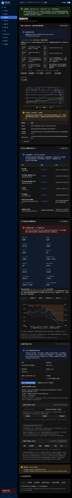
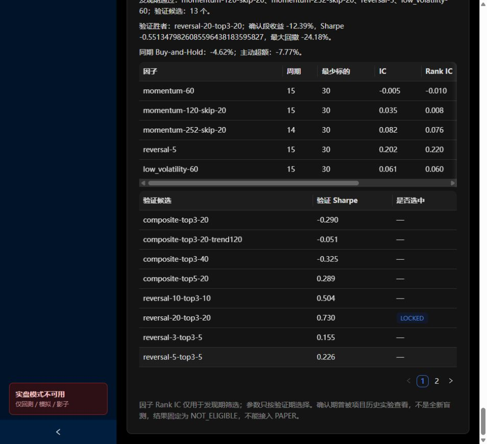

# 03｜策略研究页面导览

[返回学习目录](README.md) · [打开策略研究](https://q-trade-temp.vercel.app/#/research)

本页不是一个从上到下自动运行的任务进度条。它把新 Qlib 结果、日频证据、分钟研究和旧实验诊断放在一起。请先用下表定位，再进入专题章节。

## 1. 从上到下的组件地图

| 区域 | 正在回答的问题 | 学习章节 |
|---|---|---|
| 顶部当前数据横幅 | 当前行情是否覆盖应有完整交易日？ | 09 |
| Qlib 固定基线 | 一套明确的 ML 预测与 Top50 组合结果是什么？ | 05、07 |
| 因子定义与数据契约目录 | 已展示因子的公式、数据条件和证据在哪里？ | 04 |
| 120 日固定因子稳健性证据 | 开盘三连阳在较长历史复核中是否稳定？ | 本章第 3 节、08 |
| 分钟因子研究工作台 | 自定义开仓、退出和成本后会得到什么？ | 06 |
| 本地开仓因子候选 | 暂存并比较纯开仓规则，尚未构造策略 | 06 |
| 本地因子实验对比 | 暂存已运行策略的摘要 | 06、09 |
| 全局晋级结论 | 旧研究总体有哪些阻断原因？ | 09 |
| 底部十个页签 | 查看不同研究项目的归档诊断 | 本章第 4 节 |

顶部绿色“符合交易日历”只评价当前数据通道，不会使下方 8 月报告变成 10 月重算结果。页底全局结论也属于旧研究聚合，不能假定它逐项评价了 Qlib 新基线的全部具体门槛。

## 2. 因子目录的七列

当前显示 7 条：5 个日频因子、1 个分钟开仓因子、1 个待验证 L2 假设；这和 Qlib 的 158 个模型特征不是同一个清单。

| 字段 | 意义 | 举例 |
|---|---|---|
| 因子 | 名称与唯一 ID | momentum-60 |
| 角色 | 选股、入场择时、退出或未测试假设 | SELECTION、ENTRY_TIMING |
| 公式 | 实际计算表达式 | close_t / close_(t-60) - 1 |
| 数据与因果时点 | 所需字段、最少历史、可用时刻与最早执行 | 收盘已知 → 下一会话开盘 |
| 数据状态 | 输入是否存在、口径是否完备 | 历史可用但非 PIT |
| 有效性状态 | 某个局部门或整体研究结论 | 发现期通过但全局不可晋级 |
| 证据绑定 | 对应报告或响应哈希 | 用于追溯，不是盈利认证 |

“只读证据索引，不是 FactorRegistry”意思是：它聚合既有定义与报告，不能在这里上传一个任意公式并自动获得版本、运行和准入。导出只得到目录信息。

## 3. 120 日固定因子稳健性证据

这是“09:30 起三根十分钟阳线”因子的历史复核，**120 日是研究窗口，不是 120 日动量因子**。

实际窗口 2026-03-03—2026-08-24，75 股×120 日得到 9000 个股票日观测；首 60 日训练，后 60 日分为 6 个不重叠的 10 日测试折。

| 画面数值 | 如何解读 |
|---|---|
| 1001 个触发信号 | 9000 个股票日中满足开仓条件的次数，不是独立交易日数 |
| 全窗口收益 -27.17% | 包含训练与测试范围，不能当作全部样本外表现 |
| 全窗口超额 -5.89% | 在该模块的匹配基准下还落后约 5.89 个百分点 |
| Rank IC -0.012 | 方向分数与后续收益排序的平均联系较弱且为负 |
| NW t -0.480 | 没有支持正向日聚类条件超额的强证据 |
| 95% 区间 -0.29%～0.18% | 估计的日聚类均值区间包含 0 |
| 正向时间块 2/4 | 稳定性差；与 6 个滚动测试折是不同划分 |
| 样本外收益 -28.31% | 仅拼接后 6 折的结果 |
| 样本外超额 -12.49% | 测试段相对匹配基准落后 |
| Bootstrap 正超额频率 5.70% | 对既有测试序列的重采样结果，不是未来赚钱概率 |

七个内部页签：

1. **长期收益曲线**：策略、基准、回撤、超额来自同一固定结果。
2. **滚动测试折·6**：逐折训练窗口、测试窗口、所选阈值和测试表现。
3. **阈值压力**：固定阈值变化后结果是否敏感，不能看完挑最优再叫验证。
4. **时间稳定性**：四个连续时间块是否都出现信号、收益是否过度集中。
5. **板块拆分·15**：在不同样本行业内是否一致，不等于全市场行业认证。
6. **个股拆分·75**：表现是否依赖少数股票。
7. **研究硬门**：各项项目门槛的通过/失败。

报告的用途是保留“这个原始假设在这些条件下没有通过复核”的证据。换一个因子可以另立研究，但不应删除这份失败报告。

## 4. 页底十个研究页签

### 4.1 实验候选

显示 11 个旧不可变记录及身份检查范围。不显示完整策略血缘；它们尚未成为 StrategyVersion。不可变的含义是原结果身份固定，不是预测在未来不变。

### 4.2 因子搜索

先在发现期检查因子，再在验证期选择候选，最后展示确认段。包含因子 ID、周期数、最少标的数、IC、Rank IC、ICIR、多空分组差，以及验证候选 Sharpe。

“周期数”是统计期数，不是 60/120 等回看窗口。“多空收益差”常是最高与最低分组的收益差，不代表已经建立可融券多空组合。

LOCKED 表示此流程选择被固定，不等于预先未见全部历史。当前确认段曾被查看，因此仍是事后历史诊断。

本次看到验证赢家 reversal-20-top3-20，验证Sharpe约0.730，确认段收益-12.39%、相对基准超额-7.77%。这直接展示了“验证表现较好”与“确认表现失败”可以并存。发现期reversal-5的RankIC约0.220只来自15个统计期，不能拿它直接压过Qlib较长窗口的RankIC。

### 4.3 因子鲁棒性

观察多个季度、不同成本、邻近参数、股票子集和 Bootstrap 表现。正收益窗口比例衡量跨窗口一致性；中位 Sharpe 减少单个极端窗口的影响；最差 Sharpe 显示薄弱状态。

ROBUST 只表示满足本次设定的研究门，仍不是独立确认。2026“污染审计”表示窗口已被开发过程接触，不能再当全新测试集。

### 4.4 多板块个股迁移

将锁定规则迁移到 15 行业×5 股的另一组样本，查看 2019—2025 年度、行业内、留一行业和成本结果。

行业内测试问“只在这个行业运行怎样”；留一行业问“去掉这个行业后是否仍成立”。它们不是同一个检验，也没有自动去除行业、市值和流动性暴露。

当前股票池仍是现成成分回投，历史交易约束也不完整。换市场样本增加诊断范围，但不自动消除幸存者偏差。

### 4.5 开发区分钟策略

在开发会话中比较分钟风险覆盖策略，包括收益、对基准差、回撤改善、平均敞口和换手。“观测领先者”只是这批开发结果中领先者。

保留尾部没有进入本轮扫描，不等于这个尾部从未被项目其他历史过程看过。需要区分本轮算法没用和人类/项目从未接触。

### 4.6 未来完整日观测

这里至少有三类不同进度：

- **来源覆盖**：供应商是否能提供目标日 75 股完整数据网格及锚点一致性。
- **覆盖检查点序列**：多次发布之间就绪股票数是否回退。
- **正式未来会话计数**：有多少新完整交易日真正符合预先合同。

75/75 来源就绪不等于 20/20 前向观察，也不等于策略赚了钱。旧合同要求每股 48 根五分钟、固定标的和完整日；该要求是这一实验的证据合同，不是普遍适用于全市场所有停牌日的准则。

已存在的 368 日暖启动历史不计为新未来会话。这个页签读取的是它自己的旧前向观测合同，不能仅凭新采集器恢复，就推断它已经自动累计到今天。

### 4.7 滚动样本外

展示旧日频流程的折数、正收益折比例和拼接指标。与上面的分钟六折、Qlib 一次固定测试是不同实验。

每折测试不用于该折选择，可以减少直接选参泄漏；但如果之后不断参考所有折修改规则，整套历史也进入开发循环，独立性会下降。

### 4.8 稳健性诊断

展示压力场景数量、最差 Sharpe、指标离散程度、是否有负 Sharpe 场景。它是拒绝之后复用历史的诊断，不是补做几张图就使原失败测试重新通过。

当前此处离散度定义为各场景Sharpe最大值减最小值，不是标准差。本次显示14个场景、最差Sharpe约-1.143、离散度约1.671。开发区的“回撤改善”则应按同一符号约定比较两条最大回撤，例如-10%相对-20%改善10个百分点。

### 4.9 演化树

当前为空，因为实验没有注册策略父子血缘。空白是如实显示缺失；不能从 momentum-vol-low 等相近名称自动画出已批准演化关系。

### 4.10 未晋级

集中解释幸存者偏差、缺少 PAPER/SHADOW 等阻断。应将原因分成数据、研究设计、成交、治理和运行，后续计划才能针对具体问题。

## 5. 导出与底部全局提示

“导出全部研究证据”导出该按钮代码列明的旧研究聚合；Qlib 面板、分钟即时响应有自己的导出按钮。不要认为一次导出包含集群所有数据、模型和实验。

当前设计有较多历史项目并排展示，命名和状态还未完全统一。阅读时把每张报告看作有独立 ID、日期和合同的研究对象；不要把它们顺序拼成一条策略已经走完的审批链。

实现依据：[ResearchPage](../../web/src/pages/DataPages.tsx)、[分钟组件](../../web/src/components/IntradayFactorResearchLab.tsx)、[因子目录](../../web/src/components/FactorEvidenceCatalog.tsx)。
