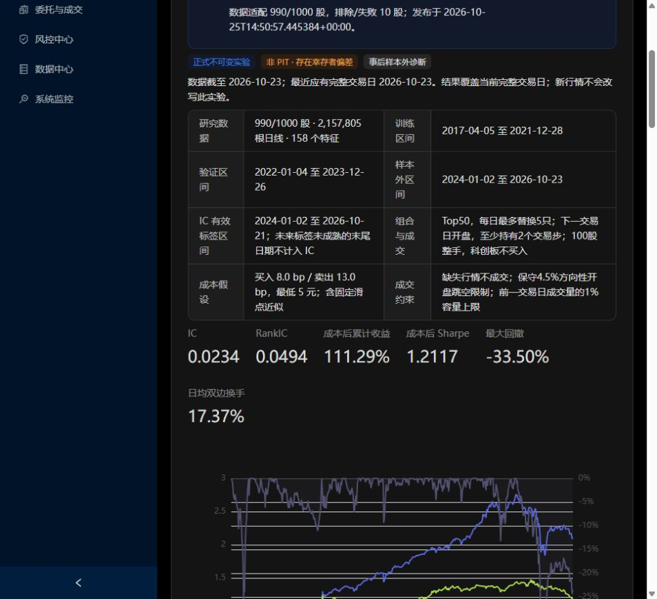

# 05｜Qlib、LightGBM 与当前固定基线

[返回学习目录](README.md)

## 1. Qlib 在当前架构中负责什么

Qlib 提供数据读取、特征表达式、训练数据集、模型、预测、组合回测和实验记录组件。当前复用这些能力，QTrade 保留采集、校验、发布与网页。它不是一个会自动补全市场数据或自动判断策略可交易的魔法盒。

官方工作流将数据、模型训练推理、信号分析、组合回测及产物记录组织起来。[Qlib 工作流](https://qlib.readthedocs.io/en/latest/component/workflow.html)

## 2. 页面每个字段

| 字段 | 本次值/含义 |
|---|---|
| 固定基线已归档 | COMPLETE：归档完成，不等于研究晋级 |
| 990/1000 股 | 请求样本中 990 股通过适配；10 股日期差异留档排除 |
| 2,157,805 根日线 | 各股已接受记录总数；不是独立样本数量 |
| 158 个特征 | 模型每个股票日的输入维度 |
| 训练 | 2017-04-05—2021-12-28 |
| 验证 | 2022-01-04—2023-12-26 |
| 历史测试 | 2024-01-02—2026-10-23 |
| IC 标签区间 | 到 2026-10-21；末端未来标签未成熟 |
| 实验 ID | alpha158-lightgbm-daily-v1-beb391a43169a5f0 |
| 代码提交 | 207a6b7a4eb324956139a98529110f166039095f |
| 结果与清单 SHA256 | 核对响应和归档身份，不能修复研究偏差 |

## 3. 模型实际学习什么

原始标签：

    y[t] = open[t+2] / open[t+1] - 1

特征使用 t 日收盘后能得到的信息。组合在 t+1 开盘交易，标签衡量之后一个开盘到开盘区间。训练时 CSRankNorm 将每个日期的标签转为横截面排名的标准化表示，所以训练目标主要是相对顺序。

IC 评价读取原始收益标签，与预测按日期配对后计算 Pearson/Spearman 相关；不把未来标签放进特征。

末两天缺成熟标签是正常边界。例如要评价 10 月 23 日信号，需要之后两个交易日开盘价格；10 月 25 日周日时还没有。不能填一个 0 让 IC 看起来“更新到最新”。

## 4. LightGBM 的直觉

一棵树把样本按若干特征阈值分组，例如“短期涨幅高且成交量变化大”的样本走某条路径；叶子给出一个数值。提升树逐轮加入新树，改善已有模型的误差。

教学例子：

    第一棵树给股票 A 分数 0.10
    下一棵树修正 +0.02
    后续修正 -0.01
    最终模型分数约 0.11

这里仅用于说明加法结构，不是本次模型的实际树或预测。分数 0.11 不表示 11% 收益或 11% 上涨概率。

LightGBM 采用直方图等方法提高树训练效率；树结构允许非线性与特征交互，但也可能拟合噪声。[LightGBM 官方原理](https://lightgbm.readthedocs.io/en/stable/Features.html)

## 5. 为什么分训练、验证、测试

- 训练：估计树结构和参数。
- 验证：早停及事前限定的选择。
- 测试：评价固定模型在未用于该次拟合的后续历史。

本次学习率 0.05、最大 31 叶、深度 6、最多 300 轮，验证早停 30 轮，固定种子 20261025，未按测试结果进行参数搜索。分区结束留有隔离，使跨未来两步的标签不穿进下一分区。

这仍是迁移后建立的事后基线；股票池按测试末期选取，历史测试也已经被查看。后续再据此调参，不能继续把同一测试叫新盲测。

当前训练一次后固定用于后续测试，并非每月滚动重训。滚动重训应成为另一份预先规定协议，保存各期模型与当时训练截止。

## 6. TopkDropout 如何把预测变成持仓

每天按分数比较现有持仓与新候选，计划淘汰靠后的持仓，补入靠前的新标的。当前 topk=50、n_drop=5、risk_degree=0.95、hold_thresh=2。

这些参数的含义：

- 50 是目标持仓数，受资格、现金和容量影响，实际可能不足。
- 5 是常态淘汰参数，初始建仓与空缺补仓不能简单理解为总共最多买 5 只。
- 95% 是股票风险资金目标，实际现金可能更高。
- 至少持有两个交易步是当前规则，不能替代完整历史可卖余额与结算约束。
- 留存股票不是每天严格恢复等权；Qlib 使用可用资金分配新买入，旧仓位会漂移。

这是多头排序组合，没有做空，也不是 LLM 自动交易。[Qlib v0.9.7 策略源码](https://github.com/microsoft/qlib/blob/v0.9.7/qlib/contrib/strategy/signal_strategy.py)

## 7. 成交和成本是假设

买入 8bp、卖出 13bp、最低 5 元，包含固定滑点近似；初始资金 1000 万元。容量取前一交易日原始成交量的 1%，再转换为当日复权股数，避免用当日完整成交量提前安排开盘交易。

历史状态不完整时使用 4.5% 方向性复权开盘跳空限制。它不是各板块真实涨跌停制度，可能拒绝可交易机会，也不能完整模拟封板、排队或价格冲击。科创板可参与训练但不买入，当前训练与投资范围存在差异。

后续应先修复历史状态、交易数量和公司行为口径，再评价新因子带来的变化。

## 8. 当前指标逐项解释

| 指标 | 值 | 可以说明什么 | 不能说明什么 |
|---|---:|---|---|
| IC | 0.02341 | 在有效日期上有较小正向线性关联 | 不是 2.341% 日收益 |
| RankIC | 0.04941 | 排序有正向关联 | 不是 4.941% 胜率提升 |
| 成本后累计收益 | 111.29% | 给定历史、样本及假设下净值约 2.113 | 不是未来收益预测 |
| 成本后年化 | 32.05% | 按 252 会话复合年化 | 不是每年实际均获得 32% |
| Sharpe | 1.2117 | 历史日收益均值相对波动 | 不是赚钱概率 |
| 最大回撤 | -33.50% | 从历史峰值的最大下跌 | 不保证未来回撤不更深 |
| 日均双边换手 | 17.37% | 买卖成交额合计相对净值较高 | 不是每天正好更换 17.37% 股票 |
| 沪深300累计 | 19.65% | 当前基准的同窗价格指数表现 | 不能单独排除行业/市值/复权口径影响 |

## 9. 读曲线时问四个问题

1. 增长是否集中在少数月份，还是跨年份稳定？
2. 相对基准的改善来自预测，还是规模/行业/流动性暴露？
3. 回撤出现时仓位和换手发生了什么？
4. 使用修复后的 PIT 股票池和真实约束，结果会变化多少？

这些问题目前没有因为一条上涨曲线就自动得到答案。

## 10. 归档与刷新

归档包含配置、数据清单、代码副本、环境依赖、Qlib 输入、模型、预测、标签、每日组合报告、持仓和校验清单。网页只展示有界摘要与曲线。

“刷新 Qlib 结果”只重新读取发布，不会按最新行情重训。新增数据或改参数需要新数据/运行版本，旧实验保持原样。GitHub 提交触发网页代码部署，与集群训练不是同一步。

本项目准确实现以 [配置](../../configs/qlib_daily_baseline.json)、[运行脚本](../../scripts/run_qlib_baseline.py)、[数据适配](../../src/qtrade/research/qlib_adapter.py)、[正式说明](../QLIB_BASELINE.md) 为准。官方 latest 文档可能高于当前锁定的 Qlib 0.9.7，复现应看锁定版本源码。
