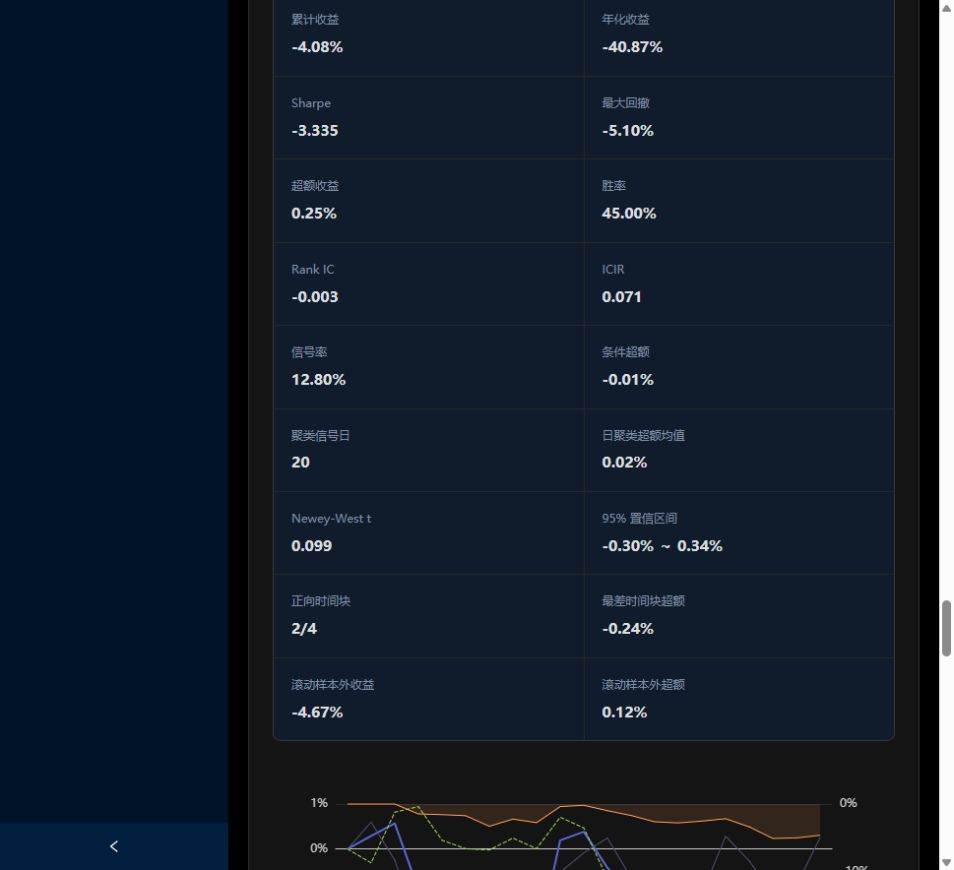
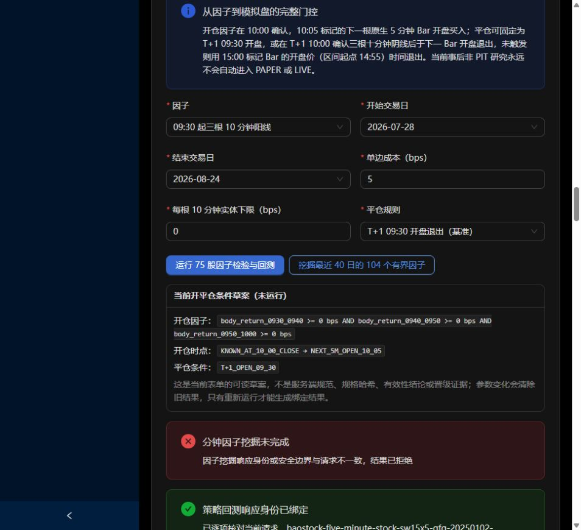

# 06｜分钟因子工作台：输入、按钮、结果与门控

[返回学习目录](README.md)

## 1. 先认识这台工作台的输入

当前读取 75 股、15 行业的冻结 BaoStock 原生五分钟数据，而不是 Qlib 的 990 股，也不是近期当前行情的所有记录。底层覆盖截至 2026-08-25，默认可作为信号日的末日是 08-24，因为 T+1 退出还需要下一会话。

它把五分钟聚合成十分钟，研究开盘前三段形态。一次“运行 75 股因子检验与回测”会同时计算信号统计、策略事件组合、稳健性和准入诊断；显示很多结果不代表这些研究阶段已经全部通过。

## 2. 每个输入控件

| 控件 | 意义 | 改动会影响什么 |
|---|---|---|
| 因子 | 三连阳，或受限自定义方向规则 | 定义信号表达式 |
| 开始/结束交易日 | 选择信号日范围 | 样本、预热、T+1 数据需求及统计稳定性 |
| 单边成本 bps | 每边固定成本代理 | 成本后策略与基准收益 |
| 每根十分钟实体下限 | 方向成立所需幅度 | 信号稀疏程度与候选身份 |
| 平仓规则 | 次日开盘，或次日三连阴否则时间退出 | 持有区间和独立平仓检验 |
| 退出阴线实体下限 | 条件平仓触发幅度 | 平仓触发样本与卖出价优势 |
| 第一/二/三段方向 | 看涨、看跌或忽略 | 哪些时段进入开仓规则 |
| ALL/ANY | 全部成立或任一成立 | 连续分数和最终触发条件 |

修改表单会使旧结果失效，需要重跑。当前开平仓“草案”只是可读表达，不是冻结注册版本。

## 3. 三段规则如何计算

每段实体收益为：

    body = 十分钟收盘价 / 十分钟开盘价 - 1

看涨使用 body，看跌使用 -body，忽略则不参与。ALL 的连续分数取参与段的最小值；ANY 取最大值。最终引擎使用：

    directional_score > threshold_bps / 10000

教学例子：三段分别 +8、+3、-2bp，全看涨时 ALL 分数为 -2bp，不满足 0bp；ANY 分数为 +8bp，满足 0bp。

当前草案文字可能显示“>=”，而实际引擎是严格“>”。所以恰好 0bp 的平盘并不算超过零阈值。应以代码和正式响应的精确定义为准；本次只记录这个边界差异。

## 4. 必须弄懂五分钟 Bar 标签

| 源 Bar 标签 | 大致对应区间 | 该 Bar 开盘价对应 |
|---|---|---|
| 09:35 | 09:30—09:35 | 09:30 附近 |
| 10:00 | 09:55—10:00 | 09:55 附近 |
| 10:05 | 10:00—10:05 | 10:00 附近 |
| 15:00 | 14:55—15:00 | 14:55 附近 |

09:35、09:40 两根形成第一段十分钟；09:45、09:50 形成第二段；09:55、10:00 形成第三段。

三段到 10:00 才全部完成。系统使用下一根“10:05 标签 Bar”的开盘价，即约 10:00 区间起点作为成交代理。**它没有真的额外等待五分钟，也没有逐笔确认信号处理之后能以该价格成交。** 这是下一 Bar 的离散回测约定，实盘处理延迟需要另行模拟。

延迟压力里的 10:05/10:10/10:15 标签分别对应约 10:00/10:05/10:10 的区间起点，也要按同一规则解读。

## 5. 两种退出规则

### 5.1 T+1 开盘

在下一交易日 09:35 标签 Bar 的开盘退出，约为 09:30。T+1 是下一交易会话，不是简单加一个自然日。周五的下一交易日可能是周一或节后。

### 5.2 T+1 三连阴，否则时间退出

次日 10:00 确认三段十分钟阴线，触发后用 10:05 标签 Bar 的开盘退出；未触发则用 15:00 标签 Bar 的开盘，即约 14:55 时间退出。

“退出因子有效”应评价触发后卖出价格相对原本固定退出价格的优势，不应只看整套策略是否赚钱。策略赚钱可能完全来自开仓，甚至平仓规则反而拖累。

该模块有独立触发次数、触发日、卖出价优势均值、NW t 和区间检验。它检验特定历史样本中的价格优势，不证明真实可成交。

## 6. 运行后出现的身份与治理组件

| 组件 | 要读的内容 |
|---|---|
| 策略回测响应身份已绑定 | 请求、数据版本/checksum、行为规格、响应哈希与安全字段是否一致 |
| 因子检验→策略回测血缘 | 是否从本次有效且非冗余的纯开仓检验手工交接而来 |
| 本次没有手工交接血缘 | 直接运行策略可以有结果，但不能伪称经过前置因子筛选 |
| 研究硬门 | 有效性、相关性、稳健性与收益等项目条件 |
| 顺序晋级停在 | 最早阻断阶段，不能跳过失败阶段 |
| 下一假设预注册 | 新假设、新窗口、候选预算、成本及泄漏审查需要冻结什么 |
| 策略注册前审查 | 行为哈希是否进一步补齐完整注册规格 |
| 流程步骤图 | 各阶段 AVAILABLE/PASSED/FAILED/DIAGNOSTIC_ONLY 等状态 |
| PAPER 模拟盘准入 | 研究、完整注册、前向证据、行情、运行证明和对账条件 |

当前实测默认规则的注册前检查为 BLOCKED，注册门 2/9、StrategySpec 字段 6/15；PAPER 准入 1/8。它们是两组不同条件，不能合并成一个百分比。

前端这一处把“因果回测收益门未通过”显示为 FAILED；这与程序是否执行成功不同。默认预览已经算完，但收益门失败。

注册前的九项检查分别是：三个顺序研究门全部通过、因果回测收益门、签名假设预注册、独立泄漏审查、行为规格哈希、完整注册规格哈希、数据身份、互斥时间切分、根/父策略血缘。已有行为哈希和数据身份，不能代替其余七项。

完整StrategySpec有15个字段：strategy_id、name、family、version、parent_strategy_id、git_commit、data_version、universe、factor_set、model、portfolio_rule、parameters、split、created_at、updated_at。6/15描述字段完备度，2/9描述审查条件数；它们不能互相换算。

PAPER八项检查可以这样理解：

| 门槛 | 为什么需要 |
|---|---|
| 历史数据身份绑定 | 知道研究实际用了哪份输入；不表示输入已无偏 |
| 因子研究硬门通过 | 有效性、冗余和稳健性证据齐备 |
| 因果回测收益门通过 | 固定规则在声明假设下满足评价条件 |
| 不可变策略版本已注册 | 运行的行为身份不能悄悄改变 |
| 真正未见前向SHADOW证据 | 检查历史开发之后的延续表现 |
| 授权实时行情就绪 | 当前公共延迟观测不能自动冒充运行级行情 |
| 新鲜运行时证明 | 确认当下状态可用，而非只看旧回测 |
| 对账就绪 | 订单、成交、持仓和资金状态一致 |

预注册卡片列出的八类要求是：新假设ID、互斥新证据窗口、独立泄漏审查、候选预算、固定稳健性情景、固定成本、数据接触前冻结规格与哈希、披露既有证据。它不会替你创建这些文件或批准下一阶段。

页面一处把前向SHADOW用作证据名称，另一处状态序列又列出PAPER→SHADOW；两处用语目前未在本页形成统一可执行流程。不要自行拼接成已完成的审批顺序；当前仍是只读阻断检查，后续接通运行前需统一状态与证据合同。

## 7. 本次实际默认预览怎么读

本次只读运行：2026-07-28—2026-08-24，三连阳、0bp 实体门槛、5bp 单边成本、次日开盘退出。

| 指标 | 页面值 | 解读 |
|---|---:|---|
| 累计收益 | -4.08% | 策略仍亏损 |
| 超额收益 | +0.25% | 相对该模块匹配基准少亏约 0.25 个百分点 |
| 年化收益 | -40.87% | 短窗口机械年化，不能预测全年 |
| Sharpe | -3.335 | 此窗口的日均回报为负且相对波动较弱 |
| 最大回撤 | -5.10% | 当前路径历史最大峰谷损失 |
| 胜率 | 45.00% | 该字段按策略日收益为正的日期比例，不是逐笔胜率 |
| RankIC | -0.003 | 本窗口平均排序联系接近 0 |
| 条件超额 | -0.01% | 按全部信号等权汇总的事件收益差 |
| 日聚类超额均值 | +0.02% | 每个有信号日先聚合、再等权平均 |
| NW t | 0.099 | 估计均值相对统计误差很小 |
| 95% 区间 | -0.30%～+0.34% | 跨越 0，未支持稳定正优势 |
| 正向时间块 | 2/4 | 时间一致性不够 |

条件超额与日聚类超额可能符号不同，因为信号很多的日期在前者权重更大。它们与成本后复合超额又不是同一个统计量。

响应哈希：ebf69b8b25cf4a80dd99a73889c22bd519477029c70db2ff004f8a9f6ad6a6e2。没有保存为正式实验，也没有本地保存。

## 8. 运行结果的七个页签

1. **因子与时序**：只读策略 ID、AD_HOC_UNREGISTERED、行为哈希、输入和执行时钟。
2. **有效性与相关性**：样本、信号、条件超额、RankIC、NW t、时间稳定性和与相关开盘特征的相关性。若选条件退出，还有平仓检验。
3. **滚动样本外与阈值**：训练选择阈值、互斥测试折、拼接收益和固定阈值敏感性。
4. **时间稳定性**：四块覆盖、信号日、均值、最差块与贡献集中度。
5. **成本压力**：0/5/10/20bp 固定成本，保持同规则，观察净收益是否依赖低成本。
6. **15 行业**：每组信号、收益与超额。分组是独立归一化诊断，不是总组合真实收益贡献拆分。
7. **75 个股**：逐股票的表现、信号与风险。看完再删除弱股属于新选择，不能沿用旧测试资格。

## 9. “104 个有界因子”设计上是什么

三段各有看涨/看跌/忽略，共 3³=27 种，去掉全部忽略剩 26 种；固定四档阈值 0/5/10/20bp，使用 ALL，因此 26×4=104。

它不是 LLM 生成 104 条新公式，而是有限枚举。前半窗口扫描、锁定一个训练赢家，后半评价固定赢家；训练排序先看训练门，再看 NW t、条件超额与更低阈值等规则。

按钮名写“最近 40 日”，该入口与普通开始/结束表单不是同一个选窗过程；应以返回的 split 为准，不要把默认普通回测的 20 日范围套进 40 日发现结果。

代码设计的后续组件包括：

| 组件 | 检验意图 |
|---|---|
| 锁定候选、训练/测试统计 | 训练好是否能延续到固定测试 |
| 0/5/10/20bp 成本压力 | 优势是否覆盖成本 |
| 行业内与留一行业 | 是否依赖单个行业 |
| 逐股票及前五集中度 | 是否被少量标的支撑 |
| 信号前市场状态 | 不同事前可知状态下是否稳定 |
| 会话内置换安慰剂 | 同日随机选相同数量股票是否也能得到相似表现 |
| 三档执行延迟 | 优势是否只存在于极窄的入场价格 |
| 1%/5%/10% 参与率 | 已完成信号 Bar 成交量能支持多少股 |
| CSCV/PBO | 反复从候选中选赢家的过拟合风险 |
| 候选表、完整发现门 | 保存失败与通过条件，避免只呈现赢家 |
| 载入锁定开仓因子 | 仅回填规则，仍需核对日期/退出/成本并重跑 |

**本次线上实测该按钮的响应被前端拒绝，未展示合法发现结果。** 页面提示“因子挖掘响应身份或安全边界与请求不一致，结果已拒绝”。上表是从当前代码核对的设计，不是本次已通过的线上功能验收。

根因本次尚未定位，不能断言是数据、后端计算还是前端验证某一项；也不能关闭校验来把它当成功结果。本次任务仅记录这一限制，未修改业务代码。

## 10. 本地开仓因子候选与相关性检验

先保存纯开仓草案，再选 2—8 条做同窗口有效性与相关性检验，最多保存 30 条。这里不需要先跑完整策略，因为它不读取平仓规则和策略收益。

检验返回信号数量、聚类日、日聚类条件超额、NW t、原始 p、Holm 校正 p，以及连续方向分数的相关矩阵。只有满足条件的规则才有手工交接意义；低相关本身不代表有效。

“进入策略构造”是把已检验开仓条件复制回表单，不会产生订单、注册版本或自动晋级。完整因子→策略联合身份包只有匹配血缘时才能导出。

## 11. 本地因子实验对比

保存的是已运行结果的摘要，包括规则、日期、身份、收益、RankIC、相关性、NW 和滚动摘要。最多 30 条，按数据版本/checksum 绑定，清浏览器数据或换设备可能看不到。

载入是恢复参数，仍需重新运行。导出 JSON 用于留档核对；当前没有导入、自动同步或自动选优。删除按钮只删除浏览器本地记录，不会删除集群正式实验。

## 12. L2 就绪卡片

UNCONFIGURED、0/6 表示六项数据前提未完成：来源授权、字段认证、股数单位、事件时钟与序号、新鲜度阈值、录制回放对账。20 个深度字段是买卖各五档的价格与数量。

“买入假设 >1”只是待检验条件；当前卖出条件也未定义。这个卡片展示的是缺口，不能解读成“平台已经有 L2 策略”。

## 13. 实现的实际边界

当前分钟模块主要对每日信号事件组合计收益：当日等权信号股票收益、无信号记零，再按日期复合。它不等同于完整现金、结算、并发持仓和真实撮合账本。

尤其条件退出可能与下一批入场时间接近或重叠；现有事件组合结果不能直接宣称已证明资金复用和成交可实现性。应把它用于研究诊断，完整账户回放需要另行验证。

源码：[IntradayFactorResearchLab](../../web/src/components/IntradayFactorResearchLab.tsx)、[intraday_factor.py](../../src/qtrade/research/intraday_factor.py)、[前端规则契约](../../web/src/research/researchWorkflow.ts)。
