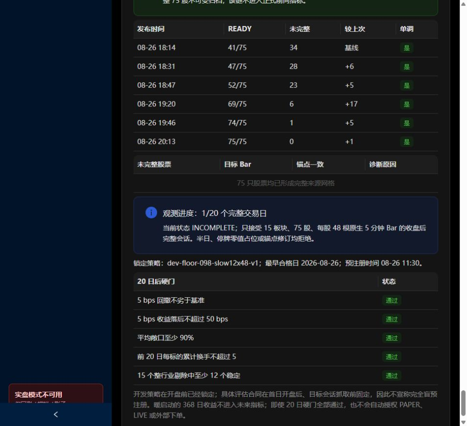

# 10｜跟站练习、答案与下一阶段计划填写表

[返回学习目录](README.md)

本章先用已有报告练习理解，不需要开展新策略搜索。想操作表单时，限定为已查看历史的教学预览，记录改动，不将结果命名为新独立验证。

## 1. 第一遍：只看对象与日期

打开策略研究，依次填下表，不先抄收益：

| 对象 | 股票/ETF 范围 | 数据/研究截止 | 是否固定归档 |
|---|---|---|---|
| Qlib | 990 股 | 行情 2026-10-23、IC 到 10-21 | 是 |
| 因子搜索 | 旧 30 ETF 研究 | 见原报告切分 | 是 |
| 120 日分钟报告 | 75 股、15 行业 | 2026-08-24 | 是 |
| 分钟即时工作台 | 同一冻结 75 股数据 | 按表单及 T+1 数据限制 | 预览 |
| 未来完整日观测 | 旧锁定 75 股协议 | 当前归档显示 1/20 | 独立旧合同 |

如果无法填出对象与日期，就先不要比较收益。990 与 75 不是同一次运行的分母。

## 2. 第二遍：读策略中心

找到“ETF 动量＋趋势波动率约束”，展开一行，按顺序解释：

1. 动量负责排名。
2. 趋势决定是否有资格。
3. 波动率缩放负责降低仓位。
4. 调仓间隔决定多久重新生成目标。
5. 成交规则决定目标是否能变成持仓。

请自己计算：目标波动率 15%，某标的估计波动率 30%，基础权重 30%，该标的目标权重约为 30%×0.5=15%。这不是保证组合波动率正好 15%。

再找到候选表的最大回撤，手动将原始小数转成百分比。确认 NONE 与 NOT_ELIGIBLE 的含义，而不是根据哪行 Sharpe 最大就挑“冠军”。

## 3. 第三遍：读一次 Qlib 结果

写成五句话：

    数据：当前流动性样本中的990股，并非历史全市场PIT池。
    特征：Alpha158价量特征。
    预测：t日收盘后预测下一开盘到再下一开盘的相对收益。
    组合：Top50、淘汰参数5、95%风险仓位，带成本与容量代理。
    结论：固定历史诊断已归档，仍有股票池、状态和成交近似限制。

如果只能说“AI 策略年化 32%”，说明还漏掉了研究最重要的定义。

## 4. 第四遍：解释一个失败报告

看“120 日固定因子稳健性证据”，回答：

- 9000 是股票日观测，1001 是信号，120 是日期数，分别是什么单位？
- 为什么只有 1/6 测试折为正比全窗口某个局部表现更值得重视？
- Bootstrap 正超额 5.70% 为什么不是“未来有 5.70% 机会赚钱”？
- 这份报告已经失败，为什么仍应保留？

答案：观察单位不同；折数检验跨时期延续；重采样只改变既有路径；保留失败可以防止重复试验和只展示获胜者。

## 5. 第五遍：默认分钟预览

默认 2026-07-28—08-24，成本 5bp、三连阳、T+1 开盘退出。本次已实测累计 -4.08%、超额 +0.25%、NW t 0.099。

请同时写三条结论：

1. 给定简化假设下，绝对收益为负。
2. 相对这个匹配基准略少亏。
3. 日聚类预测优势统计证据很弱，且其他数据限制仍存在。

三条都正确。“超额为正”不会让第一条消失；“亏钱”也不能替代对预测与成本的分别分析。

不要为了得到更好数字连续改很多参数再只保存最好一条。教学探索可以做，但每次都记录，并承认窗口已被使用。

## 6. 回测实验室的参数对照

从策略中心进入回测时，先核对模板是否实际载入；当前与历史页签是不同入口。本次未逐一完成所有模板按钮的端到端验收。

| 参数 | 改变什么 | 教学中如何控制 |
|---|---|---|
| 开始/结束日期 | 市场状态与样本长度 | 对照时保持相同 |
| 因子模型 | 动量、反转、低波动 | 一次只改变一个维度 |
| 因子周期 | 信息回看长度 | 说明预热和候选预算 |
| Top K | 分散程度与集中度 | 不与模型改变同时大幅调整 |
| 调仓间隔 | 信号刷新与交易成本 | 统计换手及持仓滞后 |
| 现金预留 | 股票风险暴露 | 与基准一致 |
| 趋势过滤/窗口 | 标的资格 | 注意它可能减少持仓 |
| 波动率开关/窗口/目标 | 仓位缩放 | 不等于新 Alpha |
| 初始资金 | 整手、最低费与容量影响 | 比较时固定 |
| 单边费率 | 成交成本 | 与滑点避免重复或遗漏 |
| 滑点率 | 成交价偏差代理 | 看实际成本合同 |

生成完整哈希草案只解决规格可识别；还需要正式持久化及独立研究设计。教学阶段不必填写虚假的源码 Commit 或把预览冒充正式归档。

## 7. 第六遍：前向观测绿色为何不等于完成

本次页面显示目标来源日 2026-08-26、75/75 来源就绪、6 个覆盖检查点、正式观测 1/20、状态 INCOMPLETE，同时五项局部风险/收益条件为绿。

应该读成：

    来源条件在那个目标日已齐；
    正式旧协议仅有1个合格会话；
    已有样本的局部数值满足若干阈值；
    样本数和整体前向观察未完成。

界面某处说明仍写“不进入0/20”，而下方正式进度为1/20，这是旧说明与实际计数之间的文案差异。应以带身份的实际计数和 INCOMPLETE 状态解释，不把文案当作新的统计结果。

## 8. 14 道自测题

| 题目 | 先自己判断 |
|---|---|
| 1. Alpha158 就是 158 条有效策略吗？ | 是/否，为什么 |
| 2. 股票从 10 跌到 9，5 日反转得分 10%，代表未来预计涨 10% 吗？ | 是/否 |
| 3. 收盘信号使用当天收盘价成交一定可行吗？ | 说明时钟 |
| 4. 五分钟10:05标签开盘等于10:05真实成交吗？ | 说明区间 |
| 5. 策略20%、基准10%，算术超额和财富比超额相同吗？ | 分别计算 |
| 6. Sharpe1.2代表120%收益吗？ | 解释比率 |
| 7. 日均双边换手20%与单边20%相同吗？ | 举例 |
| 8. IC0.03是不是每天赚3%？ | 解释相关 |
| 9. 置信区间跨0证明策略永远无效吗？ | 区分证据不足与证明 |
| 10. 换种方法复用同一测试，是否产生独立证据？ | 说明信息使用 |
| 11. 5000只当前存续股票是否消除了幸存者偏差？ | 退市样本怎么办 |
| 12. 哈希完整是否证明预先冻结？ | 时间证据在哪里 |
| 13. 本地保存是否自动同步到集群/Vercel？ | 说明存储 |
| 14. 数据FRESH是否意味着Qlib刚重训？ | 分开三只钟 |

答案：

1—2：否，特征不是策略，历史变号不是预测值。3：收盘后才知道最终价，不能无条件假设以同一个收盘价成交。4：通常是区间结束标签，开盘对应约10:00。5：10个百分点与约9.09%。6：均值相对波动。7：买10%卖10%双边20%、单边约10%。8：相关系数。9：否，可能样本不足，但当前未有清晰正证据。10：否。11：否，仍缺历史退市与动态准入。12：否，还需可信的冻结时间与数据接触记录。13：否。14：否。

## 9. 阅读完成后的研究说明模板

为任何你想继续的方向填写：

    我想验证的假设：
    经济或行为理由：
    因子公式与输入：
    数据何时可知：
    候选股票池如何按历史时点确定：
    标签与持有期限：
    对照组：
    固定组合和执行规则：
    成本、容量与交易约束：
    训练/验证/测试与隔离：
    候选与调参预算：
    主要评价指标及通过/失败标准：
    当前已查看过哪些相关结果：
    需保存的证据：
    哪些结果会使我放弃这个假设：

最后一项很重要：能够预先承认什么结果会否定自己，才能避免事后不断换解释。

## 10. 下一阶段交付计划填写表

这是给你学习后填写的空表，不表示已经启动这些工程：

| 项目 | 你确定的内容 |
|---|---|
| 阶段目标 | 例如“理解现有因子是否有增量”，而不是“多做策略” |
| 范围 | 日频/分钟，股票池，数据年份 |
| P0 数据缺口 | PIT、公司行为、状态、退市等 |
| 研究对照 | 固定信号和组合矩阵 |
| 交付产物 | 报告、清单、配置、不可变实验、网页摘要 |
| 验收方法 | 谁按什么命令或证据能重复验证 |
| 失败处理 | 保留诊断、暂停扩大搜索或更换假设 |
| 资源边界 | 数据预算、盘空间、并发、实验次数 |
| 暂缓内容 | 当前不研究的方向 |
| 完成条件 | 用可检查结果表达 |

你能按这个模板提出需求后，后续实施就能围绕明确假设和验收推进，而不是被页面上大量指标牵着走。
